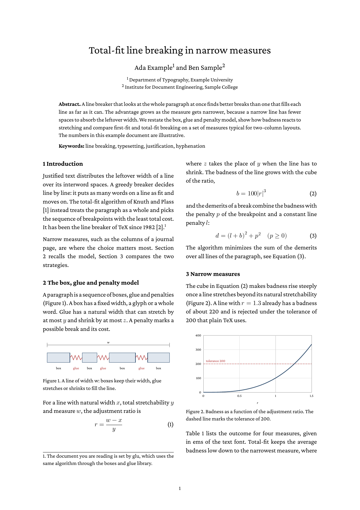
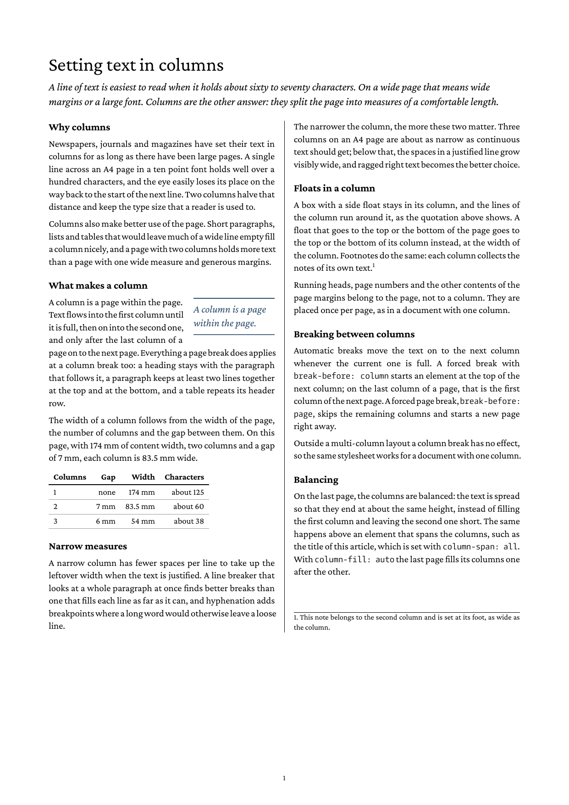
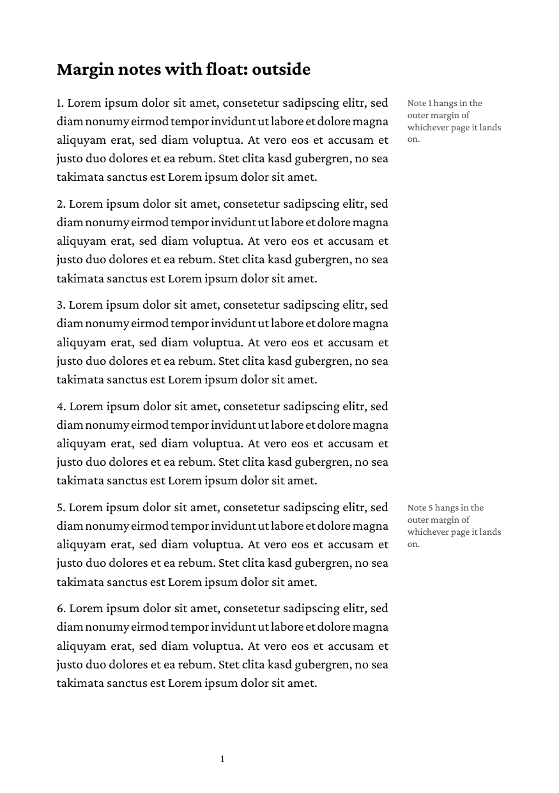
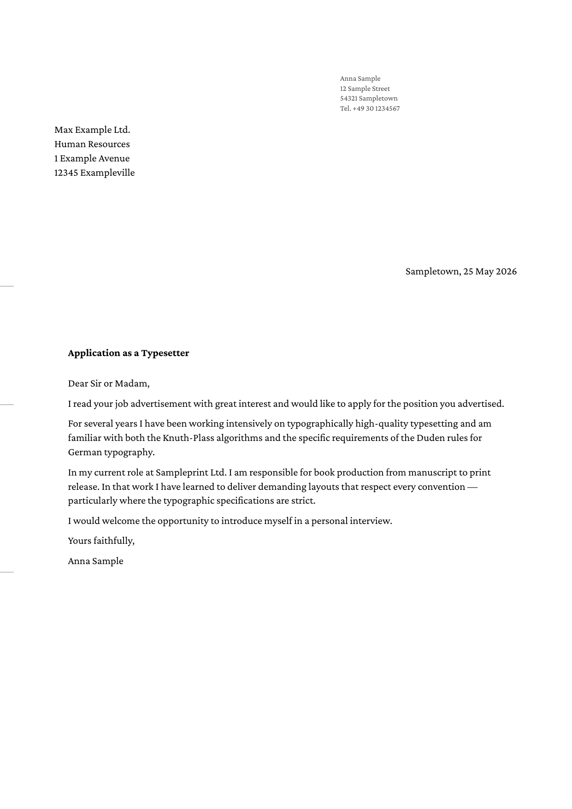
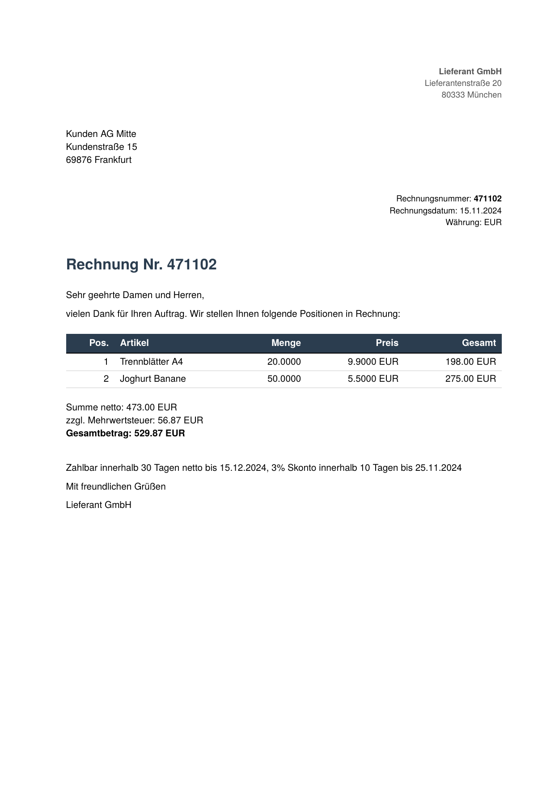
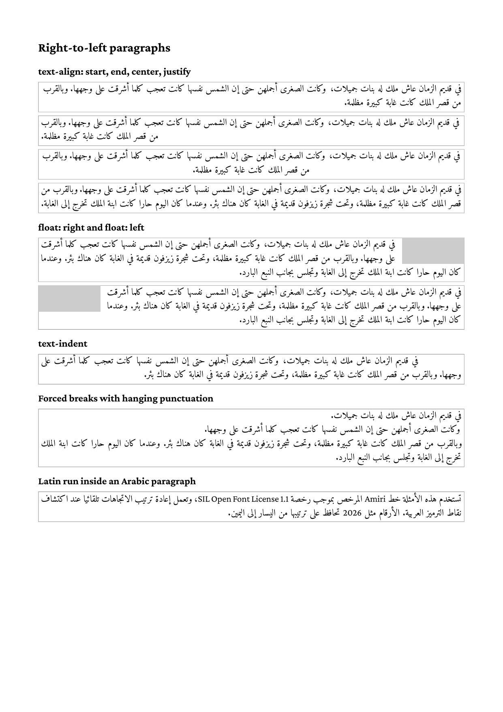

# boxes and glue examples

Working examples for [boxes and glue](https://boxesandglue.dev/), a PDF
typesetting library in Go that brings TeX's line breaking and page
layout to HTML, Markdown, XSL-FO, Lua and Go programs. Every example
holds its source, and most also the PDF it makes and a preview of the
first page.

The examples are sorted by what they show below. Most of them use
[glu](https://boxesandglue.dev/glu/), the command line tool, and need
nothing but a text editor; the others are Go programs. Where an example
has a how-to on the website, the how-to walks through it step by step.

## A first look

<table>
<tr>
<td width="33%"> <b><a href="glu/markdown/scientific-paper">Scientific paper</a></b> Two columns, equations, figures, PDF/UA-2, from Markdown</td>
<td width="33%"> <b><a href="glu/html/multi-column">Multi-column layout</a></b> CSS columns with a spanning title and balanced columns</td>
<td width="33%"> <b><a href="glu/html/margin-notes">Margin notes</a></b> Notes in the outer margin of a book page</td>
</tr>
<tr>
<td> <b><a href="glu/markdown/letter-din5008">Business letter</a></b> DIN 5008 letter with fixed address fields</td>
<td> <b><a href="glu/markdown/zugferd-invoice">Electronic invoice</a></b> ZUGFeRD / Factur-X as PDF/A-3 with the invoice XML attached</td>
<td> <b><a href="glu/html/rtl-paragraphs">Right-to-left text</a></b> Arabic paragraphs with alignment, floats and indents</td>
</tr>
</table>

## By topic

* [Articles, reports and books](#articles-reports-and-books)
* [Business documents](#business-documents)
* [Page layout](#page-layout)
* [Tables and tab stops](#tables-and-tab-stops)
* [Mathematics](#mathematics)
* [Text, fonts and languages](#text-fonts-and-languages)
* [Images, charts and barcodes](#images-charts-and-barcodes)
* [Accessible PDF (PDF/UA)](#accessible-pdf-pdfua)
* [Smallest programs and PDF internals](#smallest-programs-and-pdf-internals)

The second column names the input: glu reads Markdown, HTML, XSL-FO
(through a Lua walker), JATS XML or a Lua script. bagme is a Go package
that typesets HTML and CSS, the Go API is boxes and glue itself, and
baseline-pdf is the low-level PDF writer beneath it.

### Articles, reports and books

Example | Made with | Shows
--- | --- | ---
[Scientific paper](glu/markdown/scientific-paper) | glu, Markdown | Two-column article with an abstract across both columns, numbered equations, figures, a table, footnotes and references; PDF/UA-2 ([how-to](https://boxesandglue.dev/glu/howto/scientific-paper/))
[JATS article](glu/jats) | glu, JATS XML | A journal article in JATS, the XML of PubMed Central, with MathML formulas, figures and references
[Accessible report](glu/markdown/accessible-report) | glu, Markdown | A report tagged as PDF/UA-2 by one line in the frontmatter ([how-to](https://boxesandglue.dev/glu/howto/accessible-report/))
[Table of contents](glu/markdown/toc-target-counter) | glu, Markdown | A contents list whose page numbers and dot leaders come from CSS ([how-to](https://boxesandglue.dev/glu/howto/toc-target-counter/))
[Cross references](glu/markdown/cross-reference-inline) | glu, Markdown | References to headings and inline anchors with their text and page number filled in by CSS
[Numbered sections](glu/html/numbered-sections) | glu, HTML | Section numbers hanging in the left margin, as in rule books and legal texts
[Numbered sections with counters](glu/html/numbered-sections-counters) | glu, HTML | The same layout with the numbers counted by CSS counters
[Highlighting](glu/markdown/highlighting) | glu, Markdown | Highlighter marks and strikethrough in a draft ([how-to](https://boxesandglue.dev/glu/howto/highlighting/))
[Slides](glu/markdown/slides) | glu, Markdown | A 16:9 slide deck with curves drawn by Lua

### Business documents

Example | Made with | Shows
--- | --- | ---
[DIN 5008 letter](glu/markdown/letter-din5008) | glu, Markdown | A German business letter with fixed fields for sender, recipient, date and fold marks ([how-to](https://boxesandglue.dev/glu/howto/letter-din5008/))
[Letterhead](glu/html/page-background-letterhead) | glu, HTML | A PDF letterhead behind the text, different on the first page ([how-to](https://boxesandglue.dev/glu/howto/letterhead-background/))
[ZUGFeRD invoice](glu/markdown/zugferd-invoice) | glu, Markdown | An EN 16931 invoice as PDF/A-3 with the XML attached, set up by a companion Lua file ([how-to](https://boxesandglue.dev/glu/howto/zugferd-invoice/))
[ZUGFeRD invoice](glu/lua_interface/zugferdinvoice) | glu, Lua | The same kind of invoice built entirely with the Lua API
[ZUGFeRD invoice](bagme/formats/zugferd) | bagme | The invoice from a Go program with `WithZUGFeRD`
[Accessible ZUGFeRD invoice](bagme/formats/zugferd-accessible) | bagme | PDF/A-3b and PDF/UA-1 in one document

### Page layout

Example | Made with | Shows
--- | --- | ---
[Multi-column layout](glu/html/multi-column) | glu, HTML | Two columns with a title across both and balanced columns on the last page
[Margin notes](glu/html/margin-notes) | glu, HTML | Notes in the outer margin with `float: outside`, on the right of right pages and the left of left pages ([how-to](https://boxesandglue.dev/glu/howto/margin-notes/))
[Text around images](glu/html/image-runaround) | glu, HTML | Pictures and a box of facts floated left and right, with the text flowing around them ([how-to](https://boxesandglue.dev/glu/howto/image-runaround/))
[Floats next to each other](glu/html/floats-side-by-side) | glu, HTML | Several floats on one side, standing next to each other
[Running footer](glu/html/running-footer) | glu, HTML | A footer repeated on every page with CSS running elements ([how-to](https://boxesandglue.dev/glu/howto/page-headers-footers/))
[Top and bottom floats, footnotes](glu/html/floats) | glu, HTML | Floats at the top and bottom of the page and footnotes, in five steps
[Floats in XSL-FO](glu/xslfo/04-float-mixed) | glu, XSL-FO | `fo:float` and `fo:footnote` on one page; see also [02](glu/xslfo/02-float-top) and [03](glu/xslfo/03-float-bottom)
[Page breaks](bagme/basic/multipage) | bagme | Automatic page breaks and forced ones with `page-break-before`
[Placing at a position](bagme/basic/position) | bagme | HTML set at absolute coordinates with `OutputAt`

### Tables and tab stops

Example | Made with | Shows
--- | --- | ---
[Table column widths](glu/markdown/table-column-widths) | glu, Markdown | Column widths for HTML tables and Markdown pipe tables ([how-to](https://boxesandglue.dev/glu/howto/table-column-widths/))
[Zebra-striped table](glu/html/zebra-table) | glu, HTML | Striped rows and a totals footer from CSS structural selectors, no classes needed
[SVG in table cells](glu/html/svg-in-table) | glu, HTML | A dashboard table with an SVG chart in every cell, sized to the cell
[Table with repeating header](bagme/basic/table) | bagme | A table over several pages that repeats its header
[Simple table](frontend/simpletable) | Go API | Rows and columns with the table builder
[Table with cell spans](frontend/tablespan) | Go API | `colspan` and `rowspan`
[Tab stops](glu/markdown/tab-stops) | glu, Markdown | Columns without a table: dot leaders, decimal alignment and centered captions ([how-to](https://boxesandglue.dev/glu/howto/tab-stops/))
[Tab stops](frontend/tabstops) | Go API | Left, right, center and decimal stops with leaders

### Mathematics

Example | Made with | Shows
--- | --- | ---
[TeX math in Markdown](glu/markdown/tex-math) | glu, Markdown | Formulas in TeX dollar syntax, tagged for PDF/UA-2 ([how-to](https://boxesandglue.dev/glu/howto/tex-math/))
[MathML](glu/html/mathml) | glu, HTML | Inline and display MathML with accessible formula tagging
[MathML](bagme/basic/math) | bagme | The same from a Go program, as PDF/UA-2
[Math engine](frontend/math-phase1) | Go API | Formulas built directly with the OpenType MATH engine, without MathML or TeX

### Text, fonts and languages

Example | Made with | Shows
--- | --- | ---
[Right-to-left paragraphs](glu/html/rtl-paragraphs) | glu, HTML | Arabic with all `text-align` values, floats, indents and a Latin run inside an Arabic line
[Arabic](glu/xslfo/07-rtl-arabic) | glu, XSL-FO | Arabic shaping and right-to-left order without any setting
[Mixed directions](glu/xslfo/08-mixed-ltr-rtl) | glu, XSL-FO | English and Arabic in one paragraph, each hyphenated in its own language
[Alignment and hyphenation](glu/markdown/alignment) | glu, Markdown | Heading classes, German hyphenation and fine tuning of the line breaker
[Soft hyphens](glu/xslfo/09-soft-hyphen) | glu, XSL-FO | The `hyphens` modes side by side
[Font fallback](glu/html/font-fallback-mixed) | glu, HTML | Latin, emoji and Arabic from one `font-family` list, the font chosen per character
[Color emoji (COLR)](glu/html/color-emoji) | glu, HTML | Layered color glyphs
[Color emoji (CBDT)](glu/html/color-emoji-cbdt) | glu, HTML | Bitmap color glyphs
[List markers](glu/html/marker-pseudo) | glu, HTML | Bullets and numbers styled with `::marker`
[Text shaping](glu/lua_interface/textshape) | glu, Lua | The glyphs, clusters and advances shaping returns, printed to the console

### Images, charts and barcodes

Example | Made with | Shows
--- | --- | ---
[Chart from data](glu/markdown/chart-from-data) | glu, Markdown | A Lua block turns a data table into an SVG bar chart ([how-to](https://boxesandglue.dev/glu/howto/chart-from-data/))
[Barcodes](glu/markdown/barcodes) | glu, Markdown | EAN-13, Code 128 and QR codes with the `<barcode>` element ([how-to](https://boxesandglue.dev/glu/howto/barcodes/))
[Barcodes](bagme/basic/barcode) | bagme | The same barcodes from a Go program
[Inline image alignment](glu/html/inline-image-align) | glu, HTML | An image in a line of text with `vertical-align`
[Image with percentage width](glu/html/img-percentage) | glu, HTML | A raster image sized to its container
[SVG with percentage width](glu/html/inline-svg-percentage) | glu, HTML | One SVG in three containers of different widths
[Image in the flow](glu/xslfo/05-image) | glu, XSL-FO | A PDF placed as an image, kept as vectors
[Image in a float](glu/xslfo/06-image-float) | glu, XSL-FO | A figure with caption at the top of the page
[Borders and backgrounds](bagme/basic/border) | bagme | Borders, rounded corners and background colors

### Accessible PDF (PDF/UA)

Example | Made with | Shows
--- | --- | ---
[Accessible report](glu/markdown/accessible-report) | glu, Markdown | PDF/UA-2 from Markdown ([how-to](https://boxesandglue.dev/glu/howto/accessible-report/))
[PDF/UA-1](glu/xslfo/10-pdfua) | glu, XSL-FO | A tagged PDF/UA-1 document
[PDF/UA-2](glu/xslfo/11-pdfua2) | glu, XSL-FO | The same as PDF/UA-2 on PDF 2.0
[Accessible PDF](bagme/basic/accessible) | bagme | Structure tags from HTML for screen readers
[Accessible ZUGFeRD invoice](bagme/formats/zugferd-accessible) | bagme | PDF/UA-1 together with PDF/A-3b

The scientific paper, TeX math and MathML examples are tagged as PDF/UA-2 too.

### Smallest programs and PDF internals

Example | Made with | Shows
--- | --- | ---
[Simple page](bagme/basic/simple) | bagme | HTML with CSS, lists and code blocks to PDF
[Hello world](frontend/helloworld) | Go API | Load a font, set a paragraph, write a page
[XSL-FO walker](glu/xslfo/01-basic) | glu, XSL-FO | The smallest XSL-FO document: page master, blocks, inline markup, footnotes
[Simple PDF](baseline/simplepdf) | baseline-pdf | A two-page PDF from the raw page tree
[Font](baseline/font) | baseline-pdf | A font loaded and a line of text written without the layers above
[Image](baseline/image) | baseline-pdf | A PDF page imported as a Form XObject
[Hyperlink](baseline/annotation) | baseline-pdf | A clickable link annotation
[Bookmarks, direct](baseline/outlinedirectdest) | baseline-pdf | A bookmark tree pointing at pages
[Bookmarks, named](baseline/outlinenamedest) | baseline-pdf | A bookmark tree pointing at named destinations

## By tool

* [glu](glu): all glu examples by input format, and how to install glu
* [bagme](bagme): the Go package for HTML and CSS
* Go API examples are in [frontend](frontend), baseline-pdf examples in [baseline](baseline).

## Running an example

* **glu:** inside the example's directory, run glu on the source file,
  for example `glu multi-column.html`. Where the directory holds a
  `check.json`, its `cmd` is the exact command.
* **bagme, Go API, baseline-pdf:** inside the example's directory, run
  `go run .`

Fonts used by several examples are in [fonts](fonts), images in
[images](images).

## Documentation

* boxes and glue: <https://boxesandglue.dev/>
* glu: <https://boxesandglue.dev/glu/>
* bagme: <https://boxesandglue.dev/bagme/>
* htmlbag: <https://boxesandglue.dev/htmlbag/>
* Go API: <https://boxesandglue.dev/goapi/>
