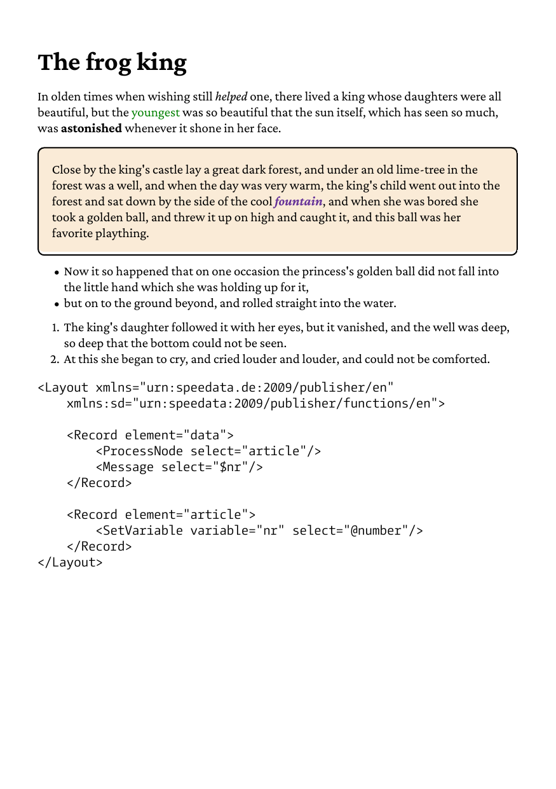
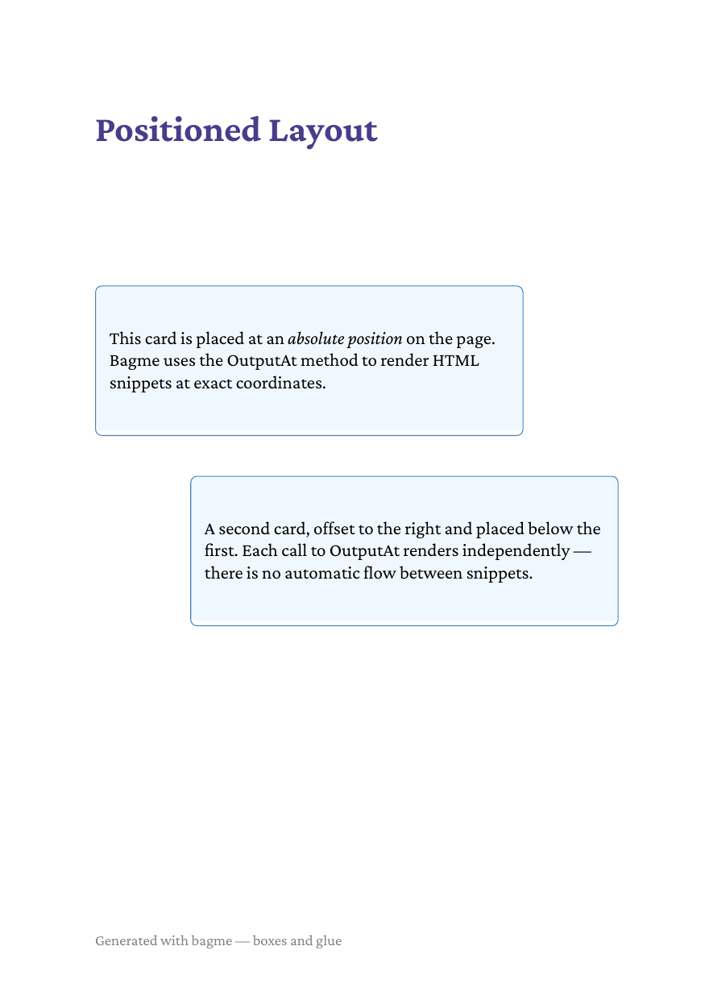
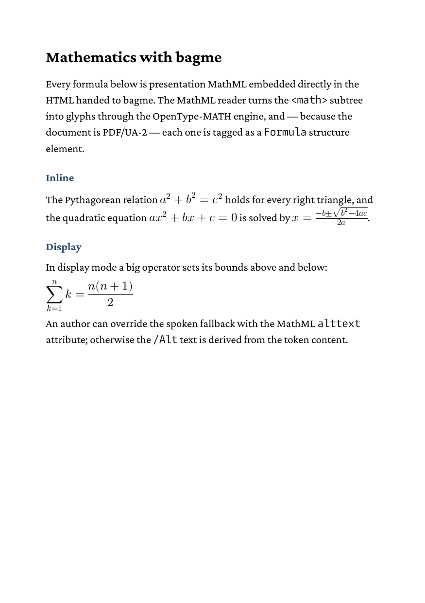
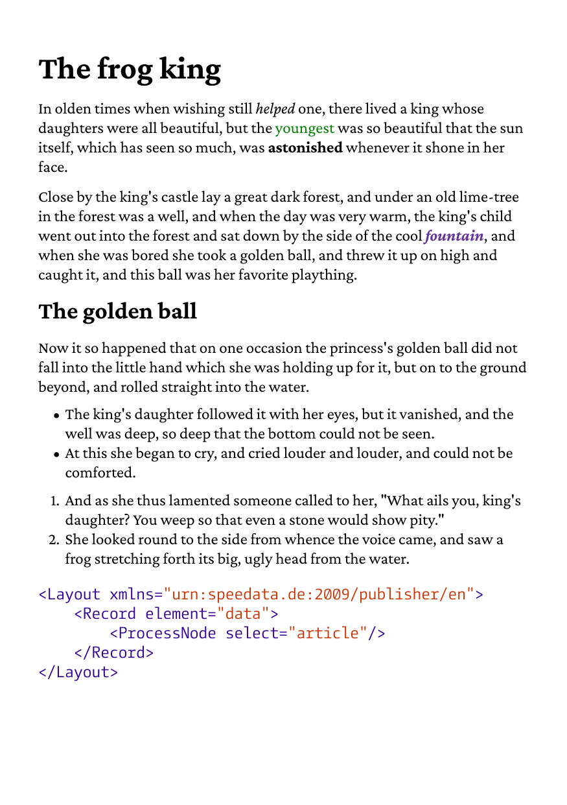

# bagme examples

Ready-to-run examples for [bagme](https://github.com/boxesandglue/bagme),
the Go package that typesets HTML and CSS to PDF with boxes and glue.
Each example is a small Go program with its HTML and CSS, the
`result.pdf` it makes and a `result.png` preview.

## Basics

Example | Description | Preview
------- | ----------- | -------
[Simple](basic/simple) | HTML with CSS, lists and code blocks | <a href="basic/simple"></a>
[Borders](basic/border) | Borders, rounded corners and background colors | <a href="basic/border"></a>
[Page breaks](basic/multipage) | Automatic page breaks, and forced ones with `page-break-before` | <a href="basic/multipage"></a>
[Positioned](basic/position) | HTML placed at absolute coordinates with `OutputAt` | <a href="basic/position"></a>
[Table](basic/table) | A table over several pages that repeats its header | <a href="basic/table"></a>
[Barcodes](basic/barcode) | QR, EAN-13 and Code 128 with the `<barcode>` element | <a href="basic/barcode"></a>
[Math](basic/math) | Inline and display MathML, tagged as formulas for PDF/UA-2 | <a href="basic/math"></a>
[Accessible PDF](basic/accessible) | PDF/UA with structure tags for screen readers, made from the HTML | <a href="basic/accessible"></a>

## Formats

Example | Description | Preview
------- | ----------- | -------
[ZUGFeRD invoice](formats/zugferd) | An EN 16931 invoice as PDF/A-3b with the Factur-X XML attached, from `WithZUGFeRD` | <a href="formats/zugferd"></a>
[Accessible ZUGFeRD invoice](formats/zugferd-accessible) | The same invoice as PDF/A-3b and PDF/UA-1 at once | <a href="formats/zugferd-accessible"></a>

## Running an example

Inside the example's directory, run

```bash
go run .
```

It writes `out.pdf`. The `result.pdf` in the repository is made the
same way with `SOURCE_DATE_EPOCH=0`, so its bytes do not change from
one run to the next.

Fonts used by several examples are in [fonts](fonts), shared
stylesheets in [css](css). The [overview](..) one level up sorts these
examples together with the glu and Go API examples by topic.
