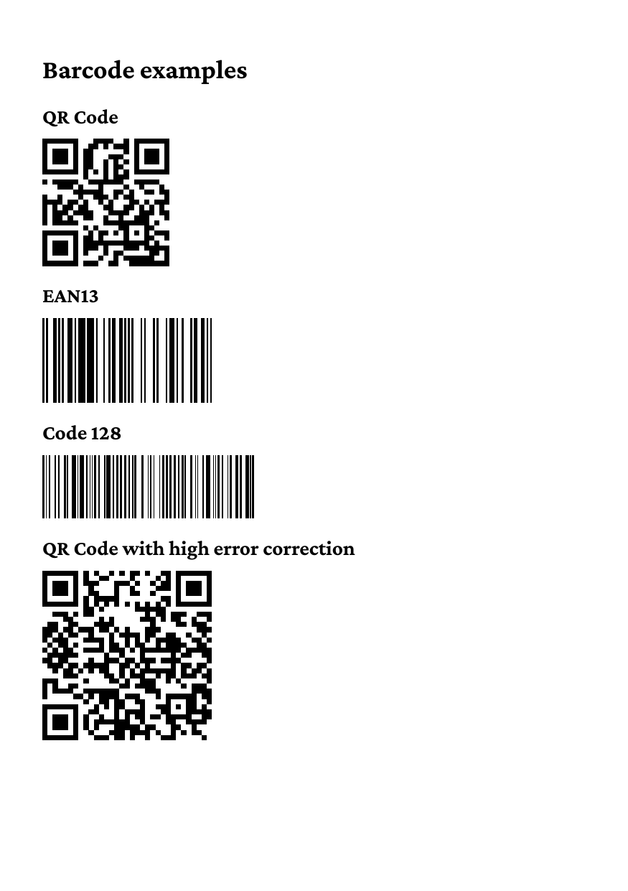

# Barcodes

The HTML element `<barcode>` in `chunk.html` draws a barcode. `type`
selects the symbology (`qrcode`, `ean13`, `code128`), `value` holds the
data, `width` and `height` set the size, and `eclevel="H"` sets the
error correction level of a QR code to high. The page shows two QR
codes, an EAN-13 and a Code 128 barcode.

To get the PDF, run

    go run .

in this directory. The program writes `out.pdf`.

The result looks like this:

