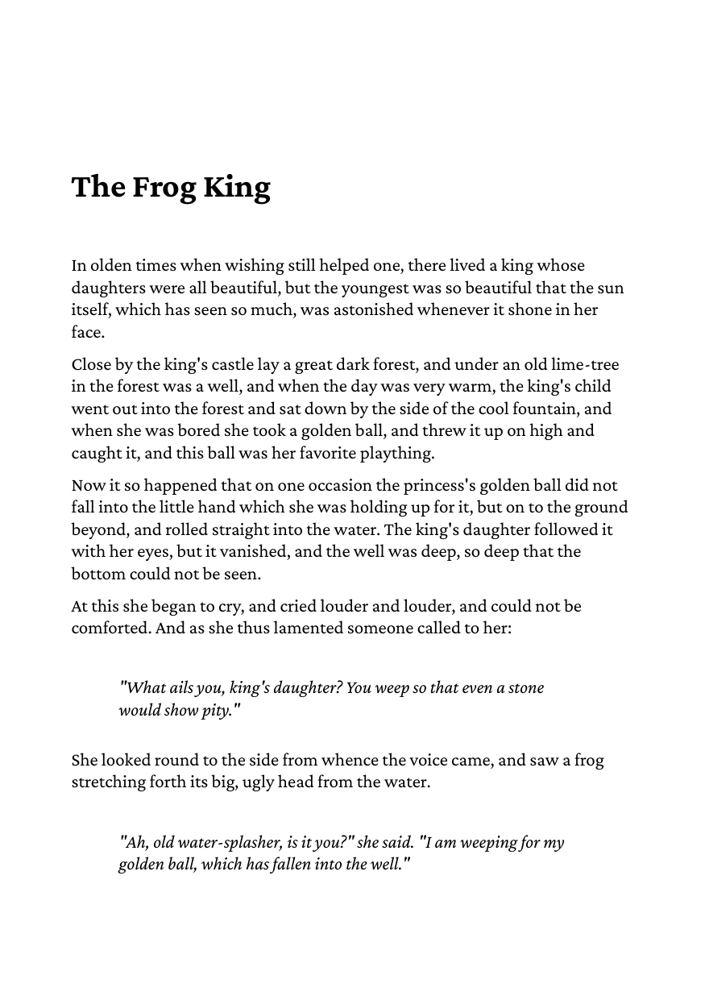

# Multiple pages

`main.go` joins two HTML files, `chapter1.html` and `chapter2.html`,
and renders them with one call to `RenderPages`. The text flows over
five A5 pages. `styles.css` sets `page-break-before: always` on `h2`,
so the second chapter starts on a new page. Block quotes are indented
and set in italics. The document is tagged for PDF/UA
(`document.WithPDFUA()`).

To get the PDF, run

    go run .

in this directory. The program writes `out.pdf`.

The first page looks like this:

