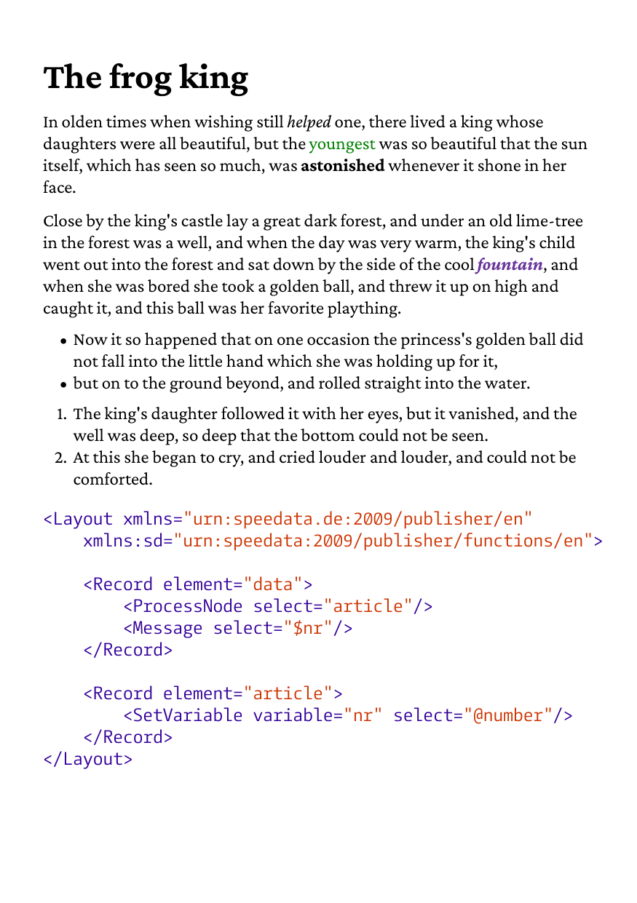

# Basic rendering example

Renders the HTML fragment `chunk.html` with the stylesheet `styles.css`
on an A5 page: a heading, paragraphs with inline styles, a bulleted
and a numbered list, and an XML code block colored by
[`syntaxhighlight.css`](../../css/syntaxhighlight.css).

To get the PDF, run

    go run .

in this directory. The program writes `out.pdf`.

The result looks like this:

