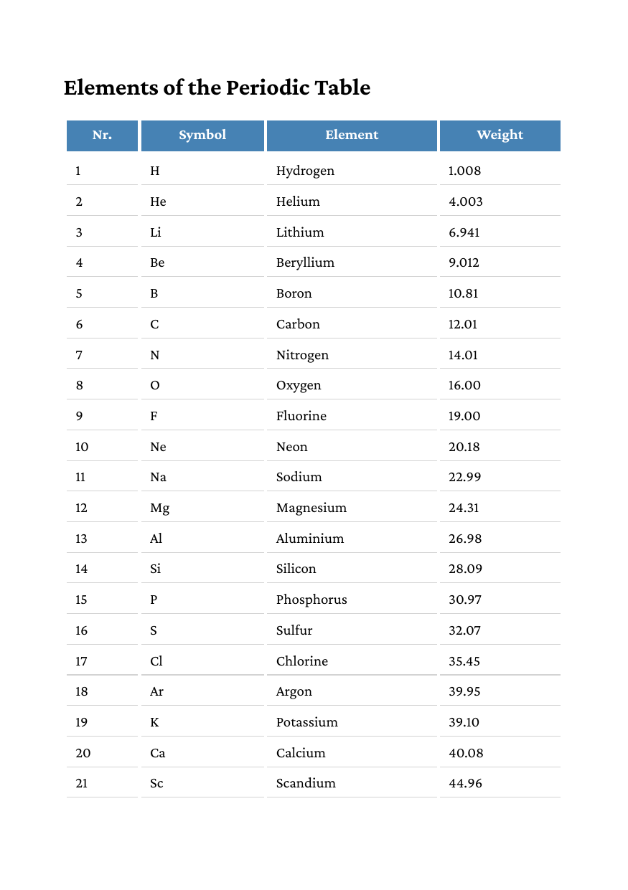

# Table with repeating header

`main.go` builds an HTML table of the first 40 elements of the periodic
table and renders it with `RenderPages`. The table does not fit on one
A5 page. It breaks onto a second page, and the header row from `thead`
is repeated there. The CSS is passed as a string to `AddCSS`, and the
document is tagged for PDF/UA (`document.WithPDFUA()`).

To get the PDF, run

    go run .

in this directory. The program writes `out.pdf`.

The first page looks like this:

