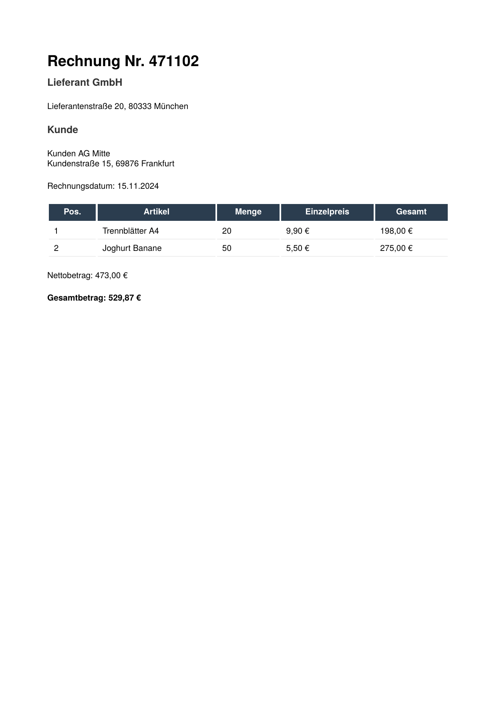

# Accessible ZUGFeRD invoice

The [ZUGFeRD invoice](../zugferd) combined with PDF/UA-1:

```go
d, err := document.New("out.pdf",
	document.WithPDFUA(),
	document.WithZUGFeRD(xmlData, "EN16931"),
)
```

The two options add up. `WithZUGFeRD` sets PDF/A-3b, attaches
`factur-x.xml` and adds the Factur-X XMP extension schema; `WithPDFUA`
adds PDF/UA-1. The PDF declares both standards and is tagged. PDF/UA
requires a title and a language, so `main.go` sets `d.Title` and
`d.Language`. The visible invoice is a shorter version of the one in
the ZUGFeRD example, without the tax lines and the payment terms.

To get the PDF, run

    go run .

in this directory. The program writes `out.pdf`.

The result looks like this:


