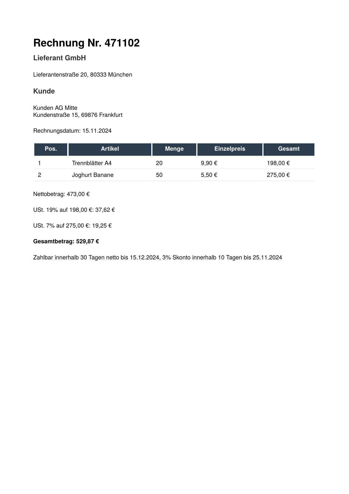

# ZUGFeRD invoice

`document.WithZUGFeRD(xmlData, "EN16931")` makes the PDF a ZUGFeRD /
Factur-X invoice. It sets the format to PDF/A-3b, attaches the invoice
data read from `factur-x.xml` under the name `factur-x.xml` and adds
the Factur-X XMP extension schema with the conformance level `EN 16931`.

The visible invoice (A4, in German, two line items, tax and totals) is
HTML written in `main.go` and styled with CSS passed to `AddCSS`. The
HTML is not generated from the XML; it repeats the values by hand.

To get the PDF, run

    go run .

in this directory. The program writes `out.pdf`. List the attachment
with `pdfdetach -list out.pdf`.

The result looks like this:

