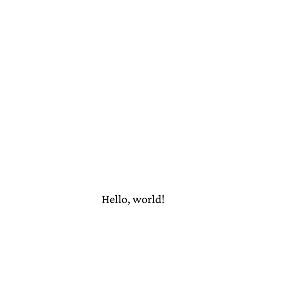

# Font

A font loaded with `baseline-pdf`, "Hello, world!" shaped with
textshape and written with `Tj`, without the frontend and without the
line breaker: the lowest level of text output.

## Run

```
go run .
```

Writes `out.pdf`.

## Result


