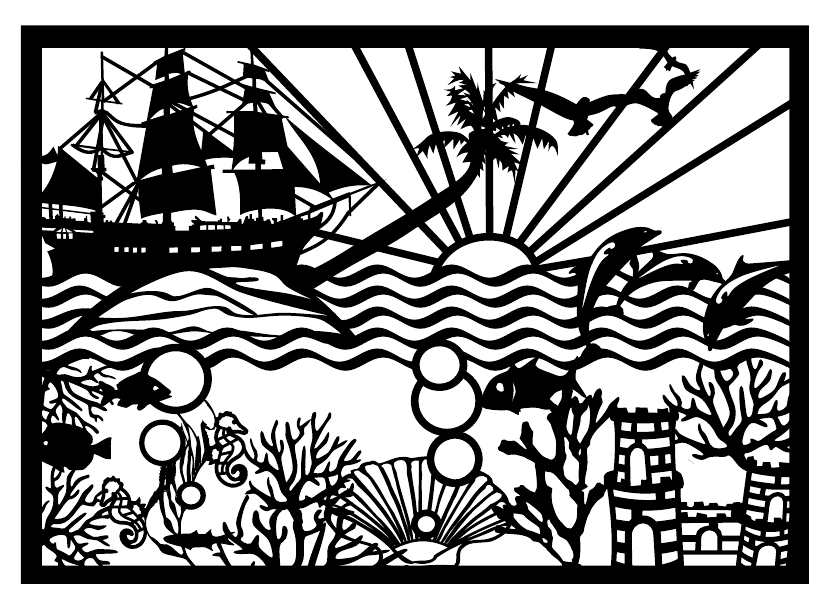

# Image

The bundled `ocean.pdf` loaded with `LoadImageFile`, which imports it
as a Form XObject, and placed on a page. The PDF stays vector graphics, so it keeps its
quality at any zoom.

## Run

```
go run .
```

Writes `out.pdf`.

## Result


