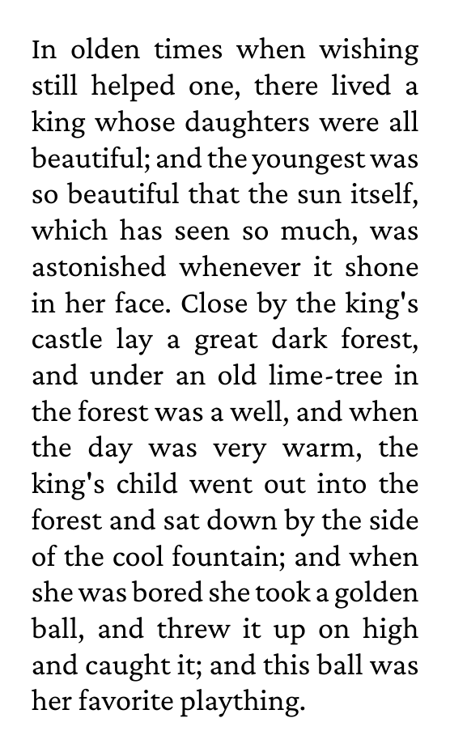

# Hello world

The smallest program for the `frontend` package: load a font family,
set a paragraph with the TeX line breaker and write a one-page PDF.

## Run

```
go run .
```

Writes `sample.pdf`. The `result.pdf` in the repository is a copy of it.

## Result


