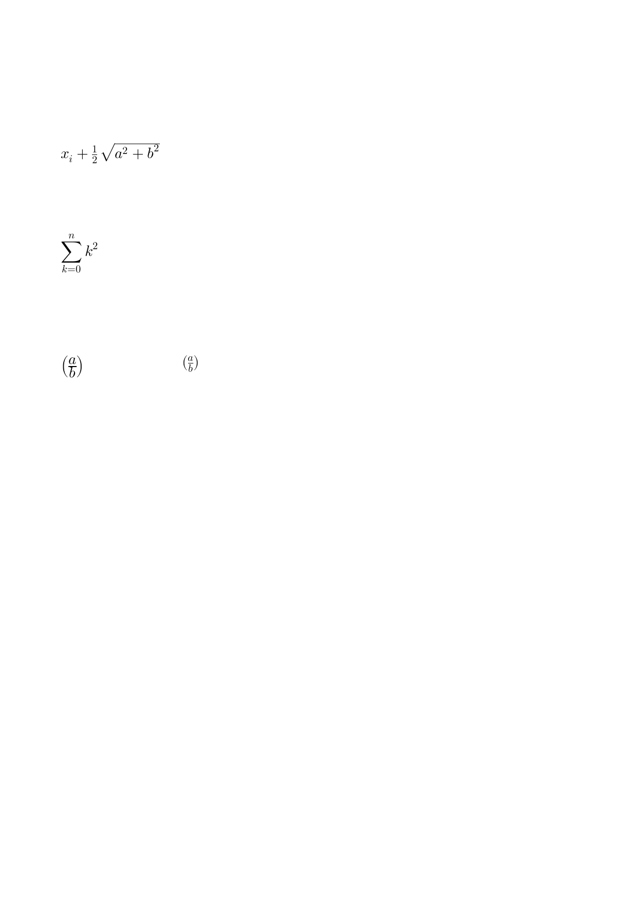

# Math engine

Formulas built directly with the OpenType MATH engine of boxes and
glue, without MathML or TeX in front: `x_i + ½ √(a² + b²)`, a sum with
limits, and a fraction in parentheses in display and in text style.

The program makes the atoms of the formulas with the Go API of
`frontend/math`, lays them out with the MATH table of Latin Modern
Math and ships them out on one page.

## Run

```
go run .
```

Writes `out.pdf`; `result.pdf` is a copy of it.

## Result


