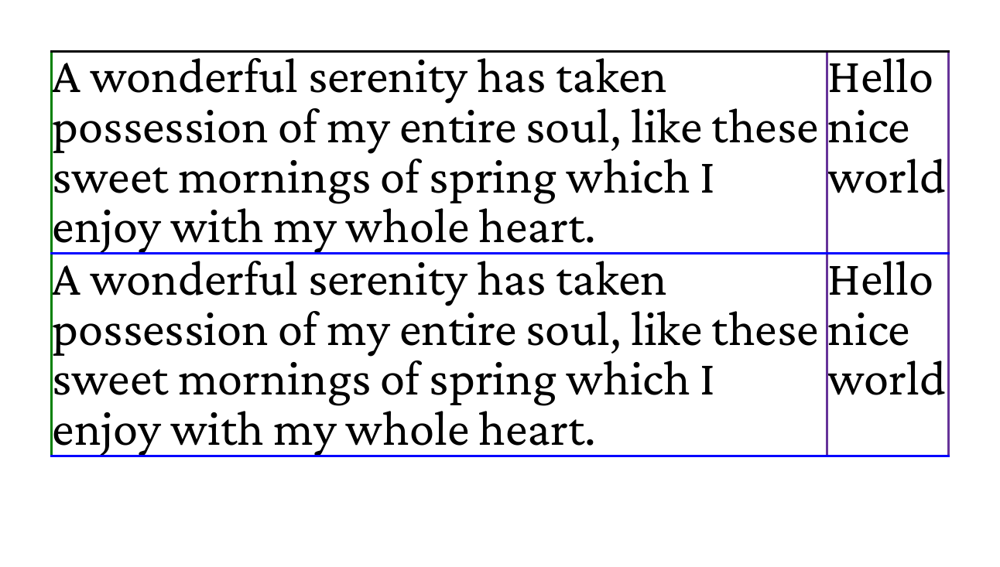

# Simple table

A table of two rows built with the `frontend` table builder: two cells
per row, set ragged right, with a border of a different color on each
side and a table width limited to the page.

## Run

```
go run .
```

Writes `sample.pdf`. The `result.pdf` in the repository is a copy of it.

## Result


