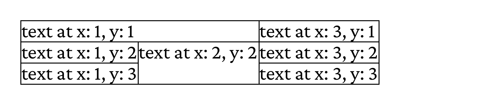

# Table with cell spans

A table of three rows and three columns in which the first cell spans
two columns (`ExtraColspan`) and the middle cell of the second row
spans two rows (`ExtraRowspan`). The cells are built in Go; the
columns are as wide as their content.

## Run

```
go run .
```

Writes `sample.pdf`. The `result.pdf` in the repository is a copy of it.

## Result


