# HTML examples

HTML and CSS typeset with glu through htmlbag, the HTML and CSS layout
engine of boxes and glue. Each example holds its HTML source, the
`result.pdf` it makes and a `firstpage.png` preview.

## Page layout

Description | Preview
--- | ---
[Multi-column layout](multi-column): an article in two columns from `column-count` and `column-gap` on the body, with a title across the columns (`column-span: all`), balanced columns on the last page, a side float and a footnote in a column | <a href="multi-column"></a>
[Margin notes](margin-notes): notes in the outer margin with `float: outside`, on the right of right pages and the left of left pages, on a book layout whose wide margin swaps sides | <a href="margin-notes"></a>
[Text around images](image-runaround): `float: left` and `float: right` for a figure with caption, an image at the start of a paragraph and a box without a width that shrinks to its content; `-bag-float-gutter` and `clear` | <a href="image-runaround">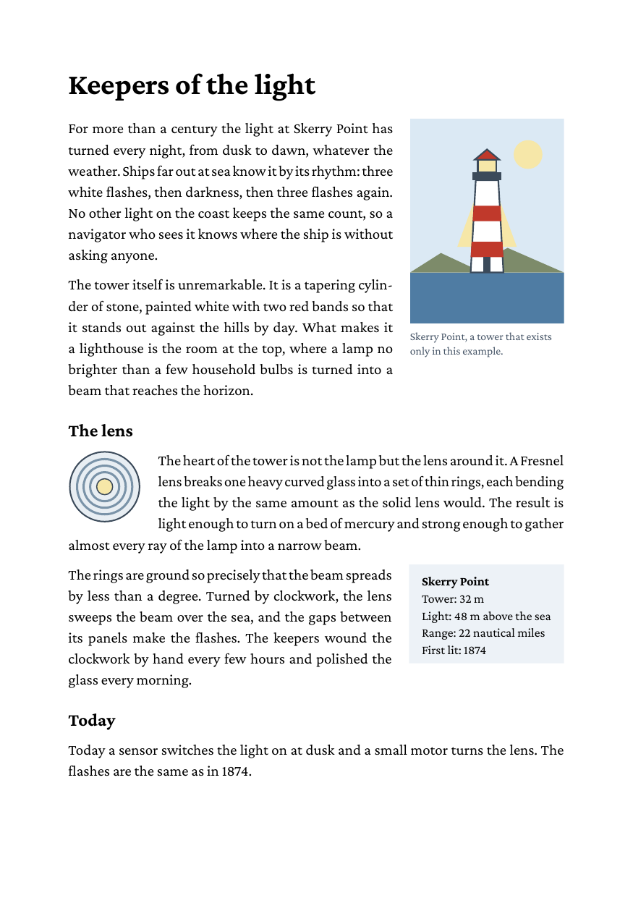</a>
[Floats next to each other](floats-side-by-side): two `float: left` figures in a row and a box of facts beside a picture on the right; the lines give way to the floats step by step as they end | <a href="floats-side-by-side">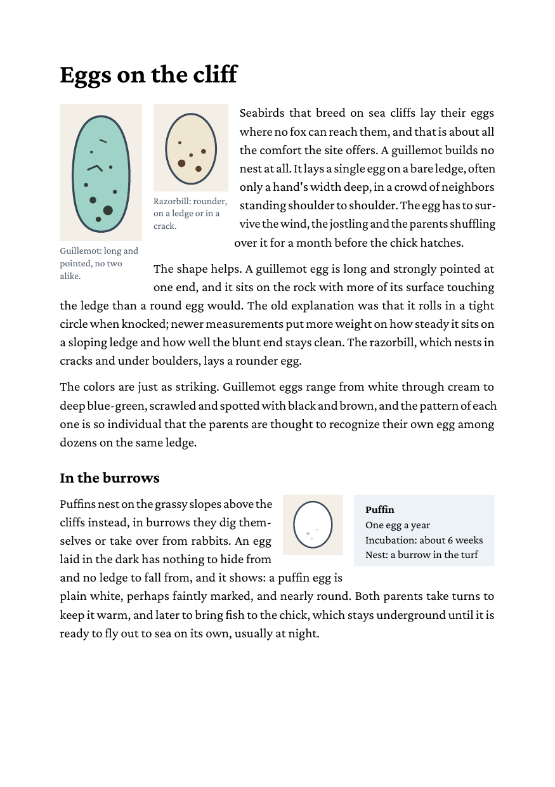</a>
[Letterhead](page-background-letterhead): a PDF letterhead behind the text, the full one on page 1 and a slim one on the pages after it, from `@page :first`, `background-image` and `-bag-background-page` | <a href="page-background-letterhead">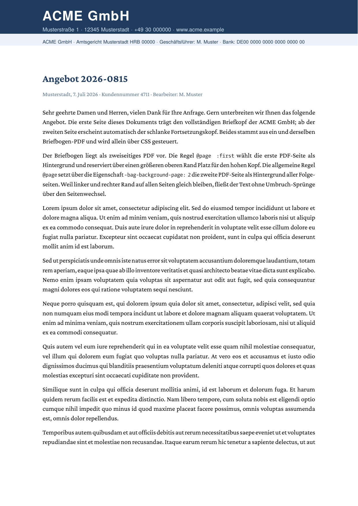</a>
[Running footer](running-footer): a three-column `<footer>` repeated in the `@bottom-center` margin box of every page with `position: running(name)` and `content: element(name)` | <a href="running-footer">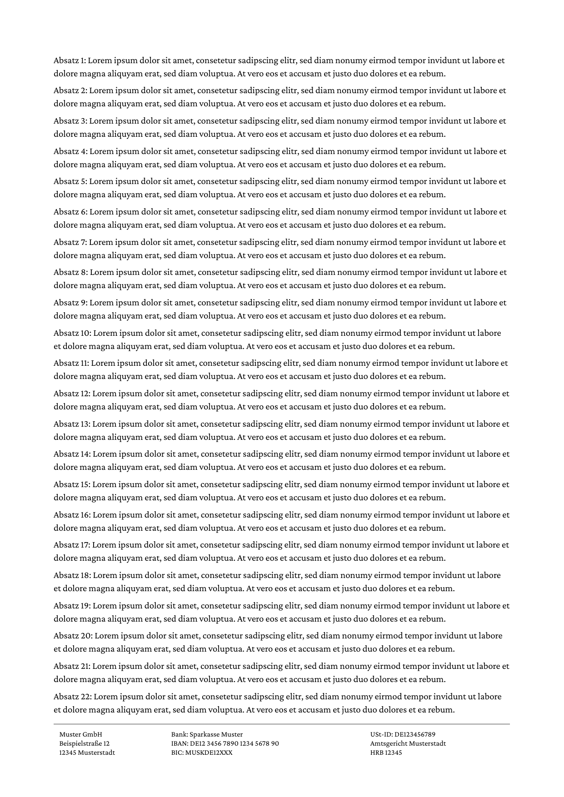</a>
[Top and bottom floats, footnotes](floats): five steps from one top float to several floats and footnotes sharing a page; the [floats Readme](floats) explains the syntax and the order the page is painted in | <a href="floats"></a>

## Tables, lists and numbering

Description | Preview
--- | ---
[Zebra-striped table](zebra-table): striped rows and a `<tfoot>` with totals from the CSS structural selectors `:nth-child(even)`, `:nth-of-type(n)`, `:not(...)`, `:first-child` and `:last-child`, without a single class | <a href="zebra-table"></a>
[SVG in table cells](svg-in-table): a dashboard table with an `<svg width="100%">` in every cell, sized to its cell | <a href="svg-in-table">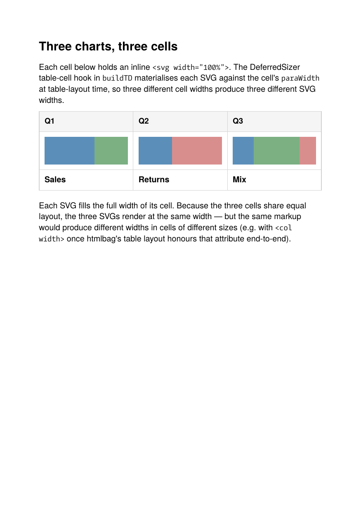</a>
[List markers](marker-pseudo): three lists whose bullets and numbers get their own color, size, font and content from `li::marker` | <a href="marker-pseudo"></a>
[Numbered sections](numbered-sections): section numbers hanging in the left margin, as in rule books and legal texts, with the numbers written in the HTML | <a href="numbered-sections">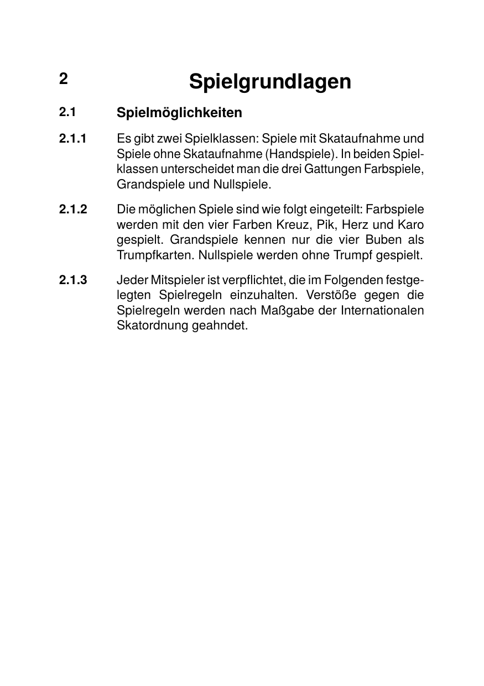</a>
[Numbered sections with counters](numbered-sections-counters): the same layout with the numbers from `counter-reset`, `counter-increment` and `counters()` | <a href="numbered-sections-counters"></a>

## Languages, fonts and math

Description | Preview
--- | ---
[Right-to-left paragraphs](rtl-paragraphs): Arabic under `direction: rtl` with the four `text-align` values, floats on either side, `text-indent`, forced breaks and a Latin run inside an Arabic line | <a href="rtl-paragraphs"></a>
[Font fallback](font-fallback-mixed): one `font-family` list for Latin from a serif face, emoji from Twemoji and Arabic from Amiri, the font chosen per character, all in one paragraph | <a href="font-fallback-mixed">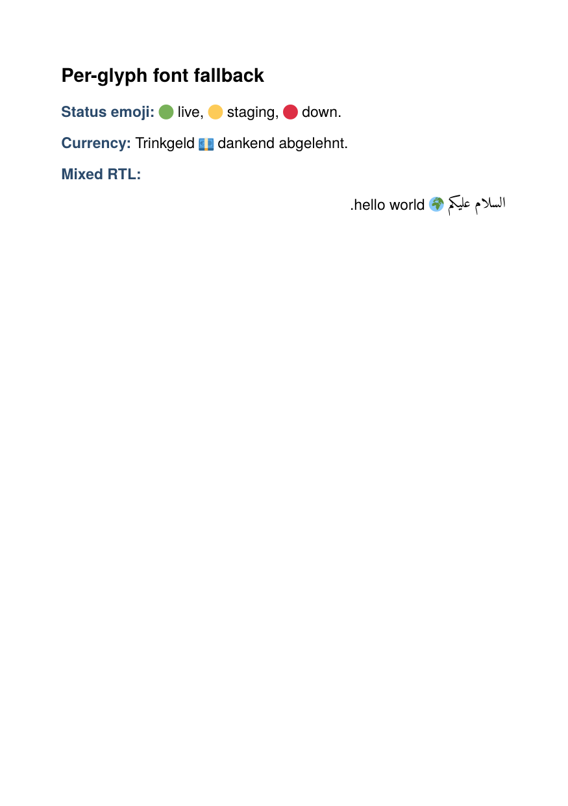</a>
[Color emoji (COLR)](color-emoji): COLRv0 color glyphs from Twemoji, painted layer by layer in the colors of the CPAL palette | <a href="color-emoji">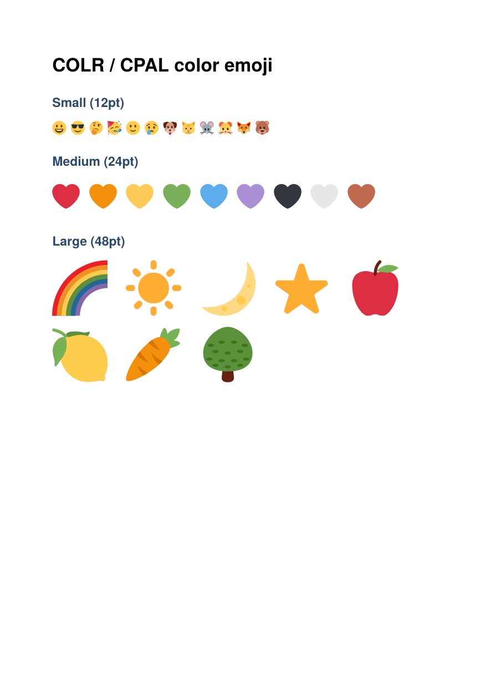</a>
[Color emoji (CBDT)](color-emoji-cbdt): color bitmap glyphs from a Noto Color Emoji subset, embedded as images | <a href="color-emoji-cbdt">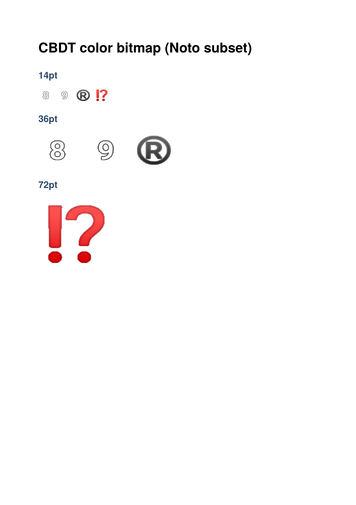</a>
[MathML](mathml): inline and display `<math>` in HTML, set with the OpenType MATH engine and tagged as formulas for PDF/UA-2 | <a href="mathml">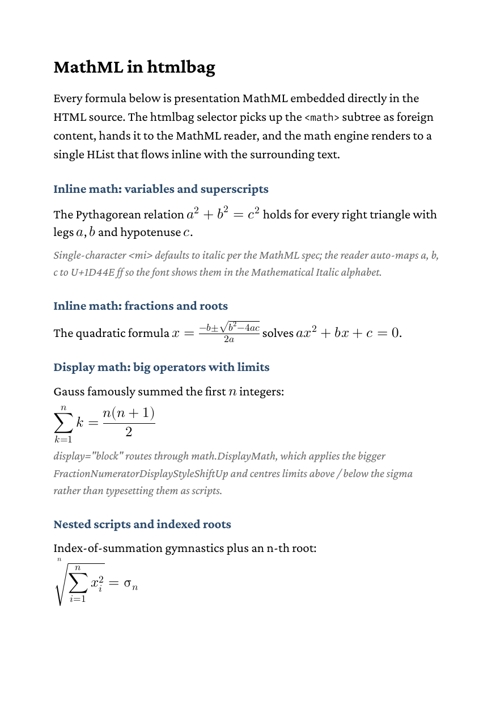</a>

## Feature tests

Small documents that show one feature in isolation.

Description | Preview
--- | ---
[SVG with percentage width](inline-svg-percentage): the same `<svg width="100%">` in containers of different widths, and a `stroke-dasharray` line | <a href="inline-svg-percentage">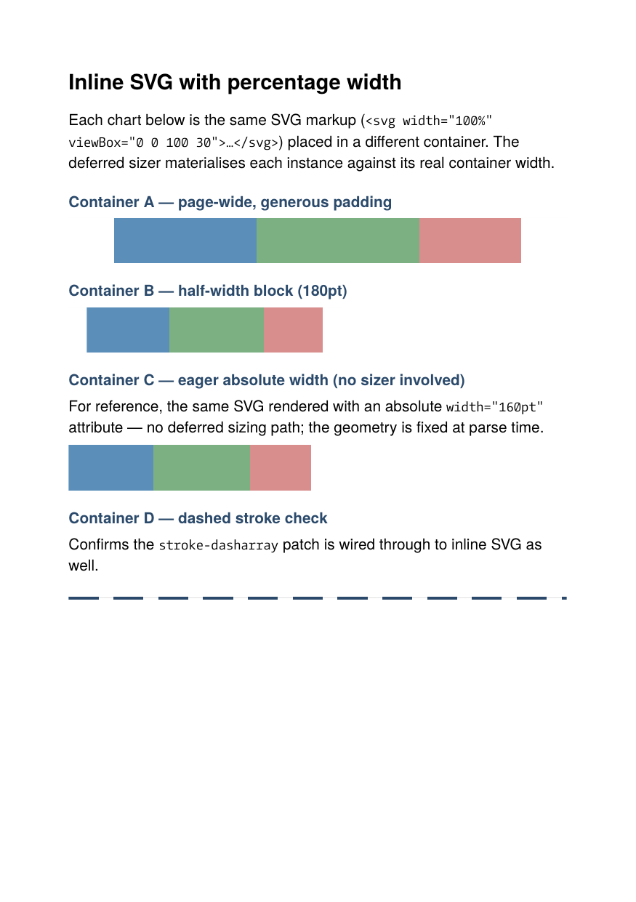</a>
[Image with percentage width](img-percentage): a raster `` sized to its container, keeping its aspect ratio | <a href="img-percentage">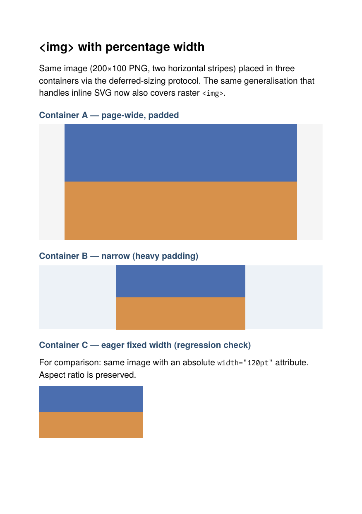</a>
[Inline image alignment](inline-image-align): an image in a line of text with `vertical-align: text-top` and `top` | <a href="inline-image-align">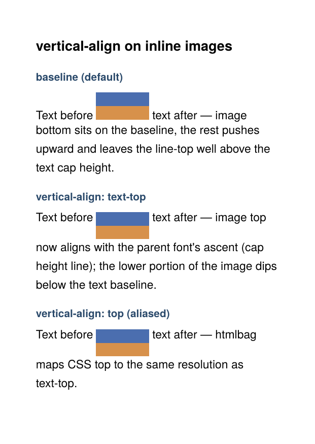</a>

## Running an example

Inside the example's directory, run

```bash
glu <name>.html -o out.pdf
```

where `<name>` is the name of the directory. The `result.pdf` in the
repository is made the same way with `SOURCE_DATE_EPOCH=0`, so its
bytes do not change from one run to the next.

## Features and where to find them

Feature | Example
--- | ---
CSS multi-column layout (`column-count`, `column-span`, balancing) | `multi-column`
Floats left, right, inside and outside, `-bag-float-gutter`, `clear` | `image-runaround`, `floats-side-by-side`, `margin-notes`
Top and bottom floats (`float: top`, `float: bottom`), footnotes | `floats/`
`@page` backgrounds and running elements in margin boxes | `page-background-letterhead`, `running-footer`
CSS structural selectors, `<tfoot>` and its `TFoot` tag | `zebra-table`
`::marker` (color, font, content) | `marker-pseudo`
Hanging list markers, CSS counters | `numbered-sections`, `numbered-sections-counters`
Inline SVG and `` with percentage width, also in table cells | `inline-svg-percentage`, `img-percentage`, `svg-in-table`
`vertical-align` on inline images | `inline-image-align`
Right-to-left text and bidi | `rtl-paragraphs`
Font fallback per grapheme cluster (CSS Fonts 4 §3.1) | `font-fallback-mixed`
COLRv0 and CBDT color glyphs | `color-emoji`, `color-emoji-cbdt`
MathML with formula tagging | `mathml`

The CSS and HTML that htmlbag supports are described in the
[htmlbag documentation](https://boxesandglue.dev/htmlbag/).
