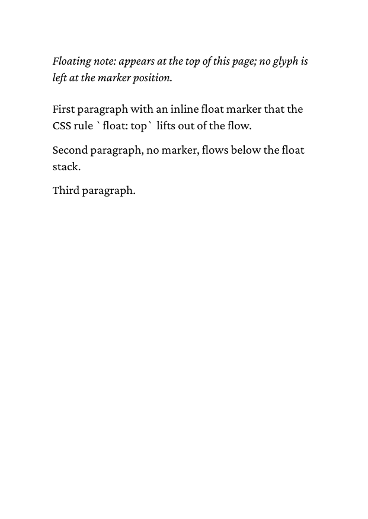

# 01 Inline top float

A `<span>` with `float: top` lifts inline content (text, inline markup,
inline images) out of the paragraph and into the stack at the top of
the page. The marker leaves no visible glyph in the body text.

## Run

```
glu 01-inline-top.html
```

This writes `01-inline-top.pdf`. The directory ships a copy as
`result.pdf`.

## Result


