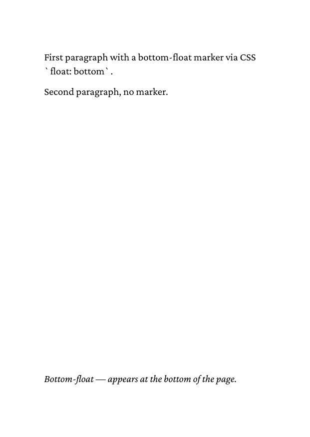

# 02 Inline bottom float

A `<span>` with `float: bottom` moves its text into the stack at the
bottom of the page, above any footnotes.

## Run

```
glu 02-inline-bottom.html
```

This writes `02-inline-bottom.pdf`. The directory ships a copy as
`result.pdf`.

## Result


