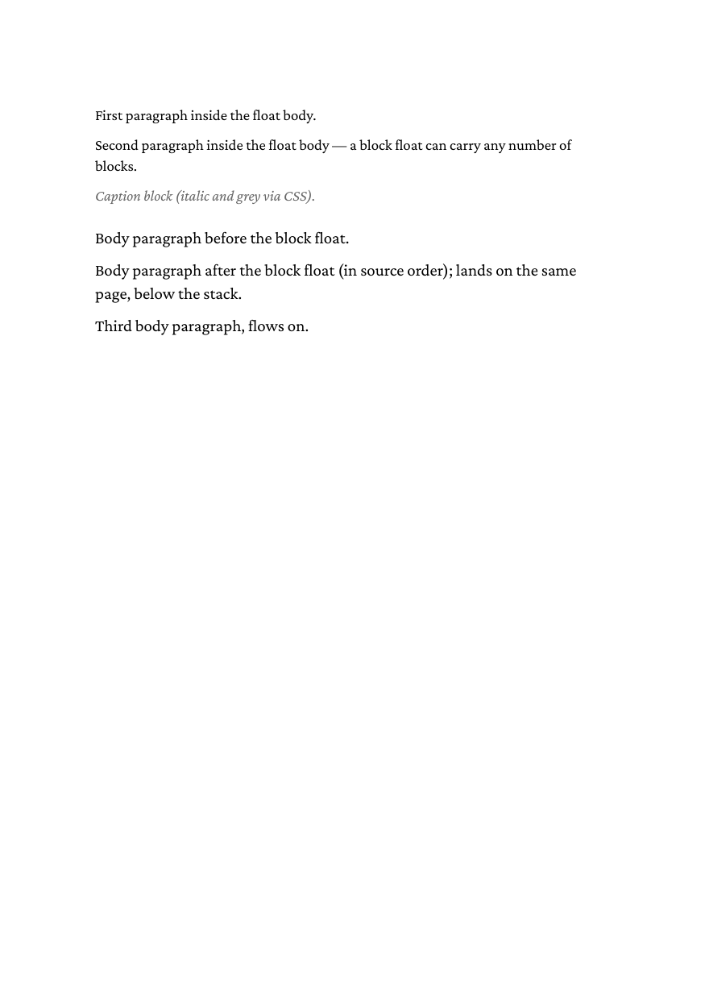

# 03 Block float, multiple paragraphs

A `<div>` with `float: top` carries several paragraphs and a caption
to the top of the page. Use a `<div>` rather than a `<span>` when the
float holds block-level content.

## Run

```
glu 03-block-multi-paragraph.html
```

This writes `03-block-multi-paragraph.pdf`. The directory ships a copy
as `result.pdf`.

## Result


