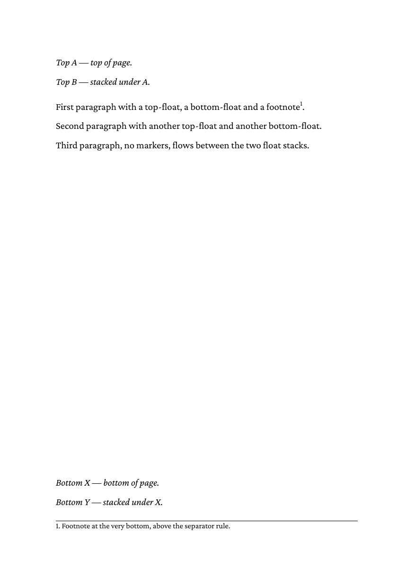

# 04 All four insert classes

Top floats, body text, bottom floats and a footnote share one page.
htmlbag places them in this order:

```
1. Top-float stack       (from the top of the text area, going down)
2. Body text             (just below the top-float stack)
3. Bottom-float stack    (above the footnotes)
4. Footnote stack        (at the bottom, below a separator rule)
```

## Run

```
glu 04-mixed-classes.html
```

This writes `04-mixed-classes.pdf`. The directory ships a copy as
`result.pdf`.

## Result


