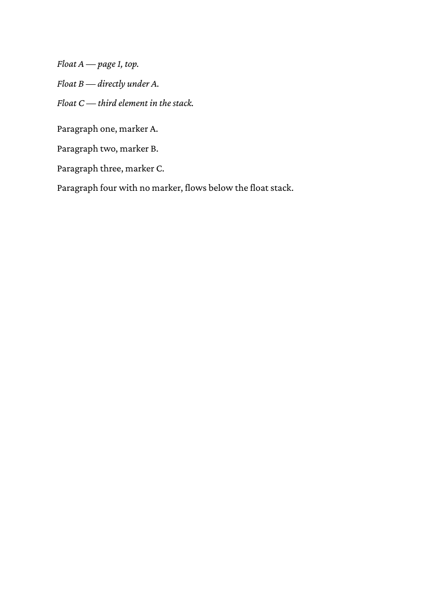

# 05 Three floats sharing one page

Three top floats from three different paragraphs stack on the same
page. htmlbag holds back the body text of a page until the page is
complete and then places it below the final float stack, so several
floats fit on one page.

## Run

```
glu 05-three-floats-one-page.html
```

This writes `05-three-floats-one-page.pdf`. The directory ships a copy
as `result.pdf`.

## Result


