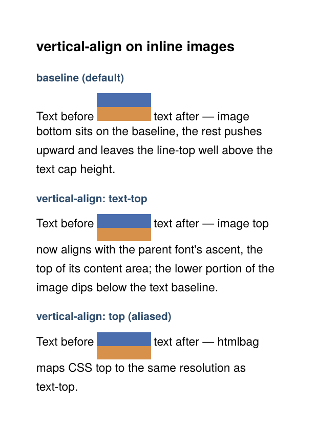

# Inline image alignment via CSS `vertical-align`

Mixed inline content (text and a raster image) in a single paragraph.
The same `` appears in three paragraphs that differ only in their
`vertical-align`:

| `vertical-align`         | Effect on the image                                |
| ------------------------ | -------------------------------------------------- |
| `baseline` (default)     | Image bottom on the text baseline; the image extends upward. |
| `text-top`               | Image top at the ascent of the parent font, the top of its content area; the image dips below the baseline. |
| `top`                    | Treated like `text-top`. htmlbag has no real line-box model, so the line-box semantics of `top` fall back to `text-top` for inline images. |

`middle`, `text-bottom`, `bottom`, `sub`, `super`, a length and a
percentage work the same way, also on an SVG in `` and on an
inline `<svg>`.

## How it works

An image, like a glyph or a box, has a height above the baseline and
a depth below it. By default the depth is 0, so the image sits on the
baseline (CSS `baseline`).

`vertical-align` splits the visible height of the image into these
two parts. For `text-top` the height above the baseline is the ascent
of the parent font, as boxes and glue reads it from the font (the top
of the content area that a browser paints an inline background over):

```
height = ascent                      // extent above the baseline
depth  = visual height - ascent      // extent below the baseline
```

The image is then drawn with its bottom at the depth below the
baseline. `text-bottom` puts the bottom at the descent, `middle` the
middle of the image at half the x-height, and a length moves the
image up or down by that much. The line grows with the image, so the
next line starts below it.

## Run

```
glu inline-image-align.html -o out.pdf
```

This produces `out.pdf`. The directory ships a copy as `result.pdf`
and a rendered preview as `firstpage.png`.

## Result


