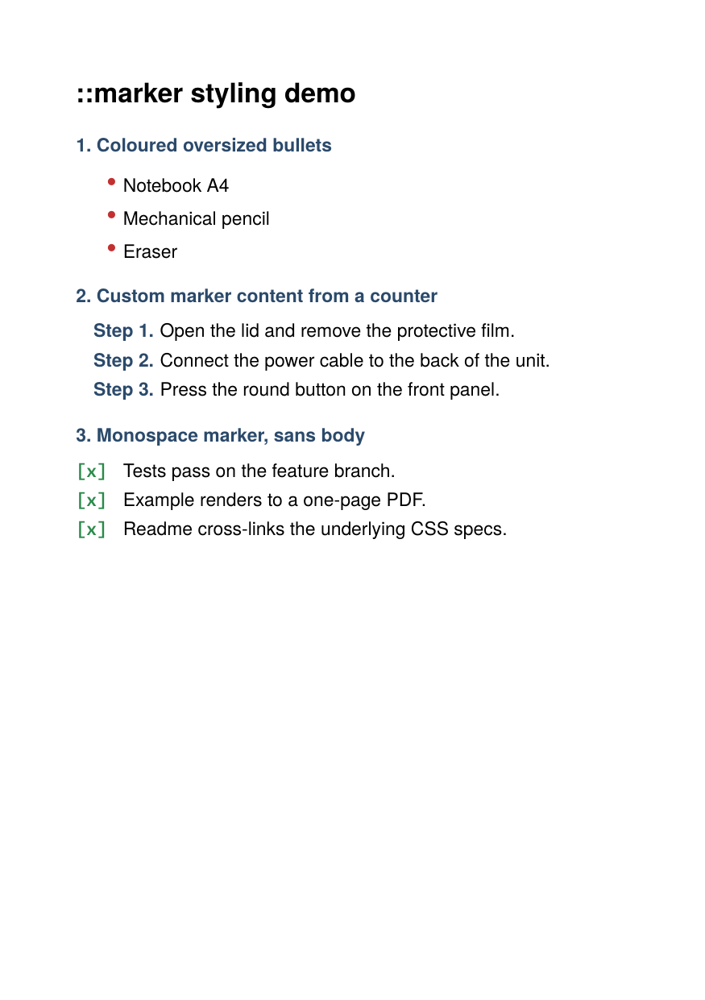

# `::marker` pseudo-element

Shows the `::marker` pseudo-element from CSS Pseudo-Elements Level 4,
which styles the bullet or number of each list item independently of
the body text. There are three lists with three marker styles, and
every visual difference comes from a `li::marker { ... }` rule.

## What is exercised

| Selector                                       | Properties verified                         |
| ---------------------------------------------- | ------------------------------------------- |
| `ul.dots li::marker`                           | `color`, `font-size` (1.6em bullets)        |
| `ol.steps li::marker`                          | `content` with `counter()`, `color`, `font-weight` |
| `ul.checks li::marker`                         | `content`, `font-family` (monospace), `color`, `font-weight` |

htmlbag supports these properties on `::marker`: `color`,
`font-family`, `font-size`, `font-style`, `font-weight`, `text-align`
and `content`. Other properties (background, padding, borders) are
ignored. The spec also restricts `::marker` to a small set of
properties, mostly those that affect the glyphs.

The older `li::before { ... }` convention, used for example in
[`../numbered-sections-counters/`](../numbered-sections-counters/),
still works: both pseudo-elements style the same marker. When both are
set on the same `<li>`, `::marker` wins.

## Run

```
glu marker-pseudo.html -o out.pdf
```

This produces `out.pdf`. The directory ships a copy as `result.pdf`
and a rendered preview as `firstpage.png`.

## Result



## Caveat: gutter sizing

The marker sits in the gutter that the list's `padding-left` opens,
with its right edge at the start of the body text. If the marker text
is wider than `padding-left`, it currently extends to the right into
the body text instead of to the left past the page edge. Browsers do
the opposite and let oversized markers hang past the edge. For that
reason the `ol.steps` list in this example uses `padding-left: 50pt`;
with a narrower gutter, `Step N.` would collide with the body text.

Changing the direction of the overflow is a separate task and not
needed for the `::marker` feature itself.
