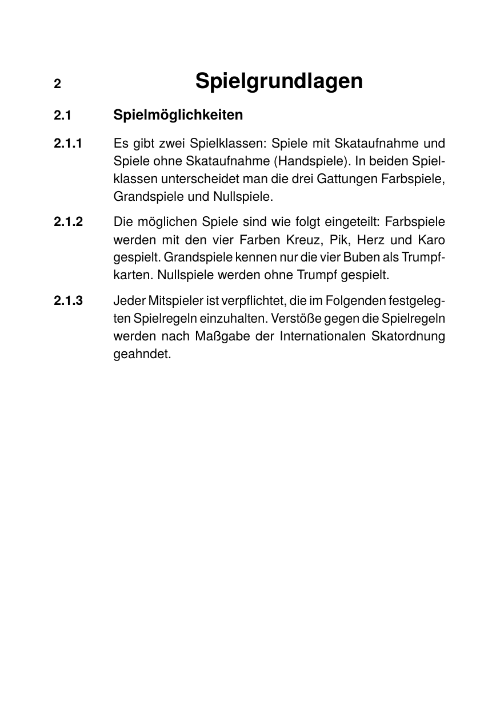

# Numbered sections with CSS counters

The same Skatordnung-style hanging-indent layout as
[`../numbered-sections/`](../numbered-sections/), but the section
numbers are not typed into the HTML. CSS counters compute them when
the document is rendered.

Three nested `<ol class="sec">` declare the hierarchy. Every level
uses the same counter:

```css
ol.sec       { counter-reset: sec; }
ol.sec > li  { counter-increment: sec; }
ol.sec > li::before { content: counters(sec, ".") "  "; }
```

`counters(name, sep)` (note the trailing `s`) joins the values of all
counters with that name along the ancestor chain. Nesting depth one
produces `"2"`, depth two `"2.1"`, depth three `"2.1.1"`. To start the
outermost counter at 2 (matching chapter 2 of the Skatordnung), the
outermost `<ol>` carries `counter-reset: sec 1`. Its first `<li>` then
increments the counter to 2.

## Run

```
glu numbered-sections-counters.html -o out.pdf
```

This produces `out.pdf`. The directory ships a copy as `result.pdf`
and a rendered preview as `firstpage.png`.

## Result



## Compare

- [`../numbered-sections/`](../numbered-sections/) writes the numbers
  into the HTML as `<td>` cells. Use that variant when the structure
  is sparse and you want full control over which numbers appear where.
- This variant binds the numbers to the document structure. Adding or
  removing an `<li>` renumbers everything after it, without manual
  fixes. The cost is a stricter HTML shape: everything must live
  inside the right `<ol class="sec">`.

## Centered chapter title with a gutter marker

The chapter title in the outer `<li>` is a `<span>` turned into a
block with `display: block` and centered with `text-align: center`.
Its marker still hangs in the gutter next to the other markers,
because htmlbag places a list marker at the start of the line
independently of the text alignment of the item.
