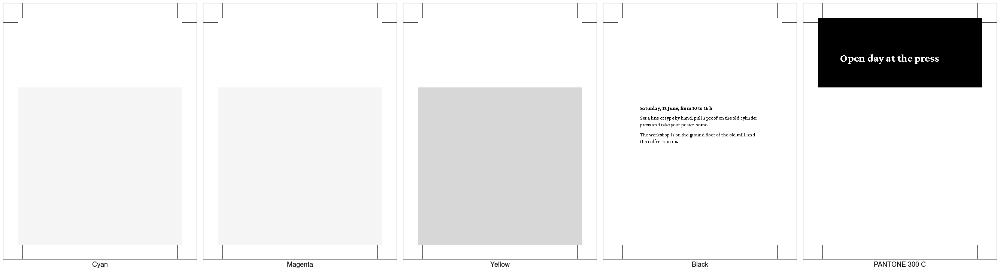

# A PDF for the print shop

An A6 flyer as a printer wants it: PDF/X-4, 3mm bleed, crop marks, one
spot color and black text that overprints the tint below it. There is
no Lua in it, the file declares everything in its `<head>`.

| Block | What to look at |
| ----- | --------------- |
| `<meta name="pdf-format">` | Selects PDF/X-4. A bare `glu print-ready.html` is enough. |
| `@-bag-color` | The inks: a spot color, two CMYK colors and an overprinting black. |
| `@page` | `size` is the trimmed page. `bleed` and `marks` come on top of it, and `background-color` runs into the bleed by itself. |
| `.band` | Absolute offsets count from the corner of the trimmed page, so `-3mm` reaches the edge of the bleed. |
| `ink` | Prints on top of the tint, so a slight misregister leaves no white edge along the letters. |

## Check the plates

Ghostscript writes one image per ink:

```bash
gs -q -o plate.tif -sDEVICE=tiffsep -r100 result.pdf
```

`plates.png` shows the result. The yellow plate runs through below the
text, which is the overprint, and the band stands on the spot color
alone. The crop marks are on every plate.



The how-to [Prepare a PDF for the print shop](https://boxesandglue.dev/glu/howto/print-ready-pdf/)
walks through the file step by step.
