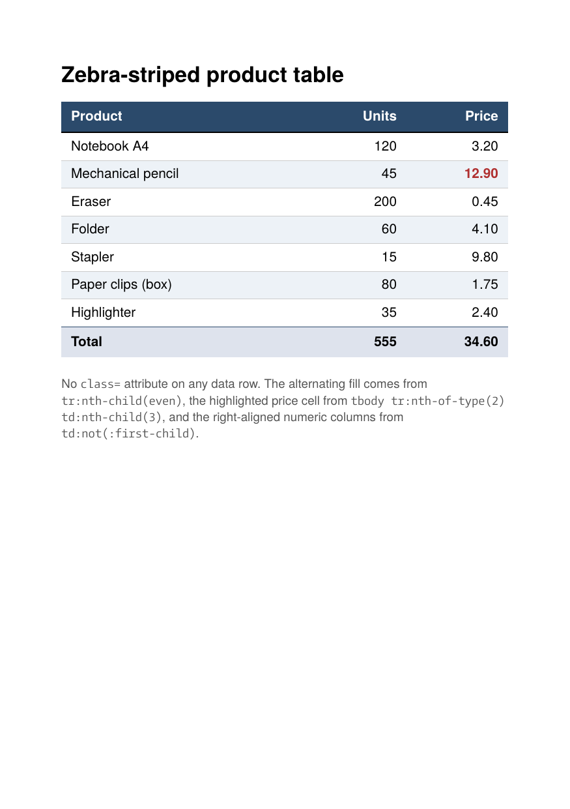

# Zebra-striped table with CSS3 structural selectors

A small test that shows htmlbag honors the CSS3 structural selectors
end to end. The data rows have no `class=` attributes: every visual
difference comes from selectors over the document structure.

## What is exercised

| Selector                                       | Visible effect                              |
| ---------------------------------------------- | ------------------------------------------- |
| `tbody tr:nth-child(even)`                     | alternating row fill                        |
| `tbody tr:nth-of-type(2) td:nth-child(3)`      | the red bold price in row 2                 |
| `td:not(:first-child)`                         | right-aligned numeric columns               |
| `tbody tr:first-child td`                      | thick top rule below the header             |
| `tbody tr:last-child td`                       | suppressed bottom rule on the last row      |
| `h1:first-child`                               | no extra top margin on the heading          |
| `thead tr`, `thead th`                         | header fill and bold text                   |
| `tfoot tr`, `tfoot td`                         | bold totals row separated by a heavy rule   |

htmlbag uses [`cascadia`](https://github.com/andybalholm/cascadia) to
parse and match selectors and applies the matched rules in order of
specificity. Any selector that cascadia understands works, and that
includes all CSS3 structural selectors.

## Run

```
glu zebra-table.html -o out.pdf
```

This produces `out.pdf`. The directory ships a copy as `result.pdf`
and a rendered preview as `firstpage.png`.

## Result



## `<tfoot>` support

htmlbag places the `<tfoot>` rows at the bottom of the table, after
the `<tbody>` rows, no matter where they appear in the source (as HTML
specifies). In PDF/UA output the footer rows are tagged with the
`TFoot` structure element.
