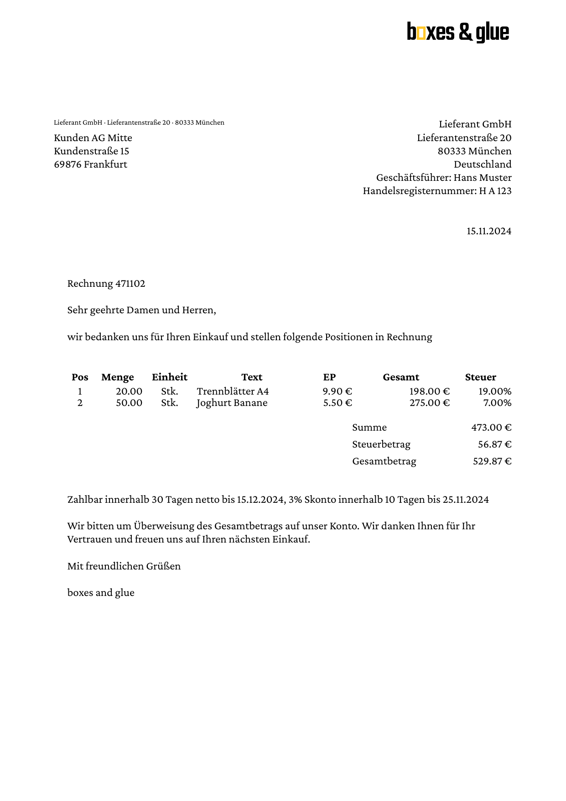

# ZUGFeRD invoice

Builds an EN 16931 / ZUGFeRD-conformant electronic invoice as a
PDF/A-3b with the structured invoice XML embedded as an attachment.

The example uses the low-level Lua frontend bindings directly:

| File | Purpose |
|---|---|
| `main.lua` | Sets up the document, color profile, font family, output file name |
| `document.lua` | Renders the visible invoice layout (logo, address block, item table, totals) |
| `zugferd.lua` | Reads the invoice data from `zugferd.xml`, attaches the file as `factur-x.xml` and adds the Factur-X XMP metadata (conformance level `EN 16931`) |
| `zugferd.xml` | Cross-Industry Invoice (CII) XML in the EN 16931 profile: the structured side of the invoice |
| `AdobeRGB1998.icc` | Output intent for PDF/A-3 |
| `img/logo.pdf` | Sample company logo |

## Run

```
glu main.lua out.pdf
```

The result is written to `out.pdf`. Without the argument the script
writes `result.pdf`, the file checked in here. List the attachment with
`pdfdetach -list out.pdf`.

## Result


