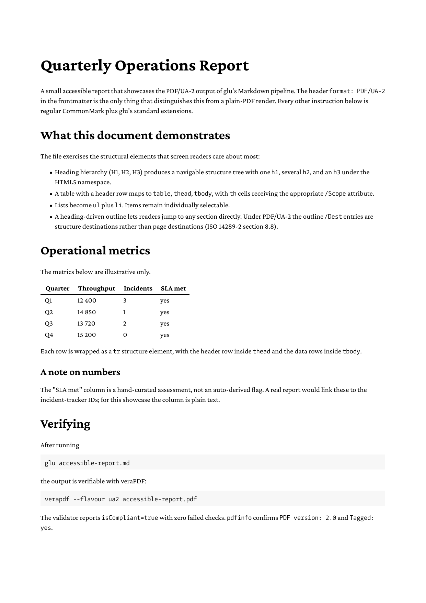
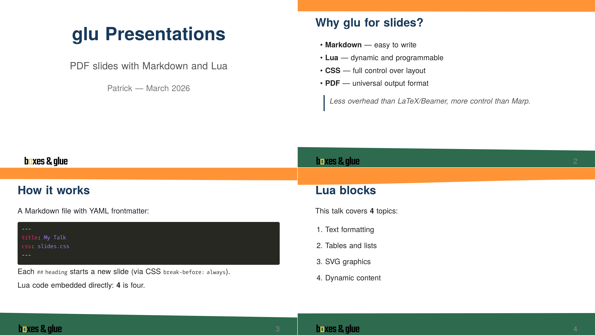
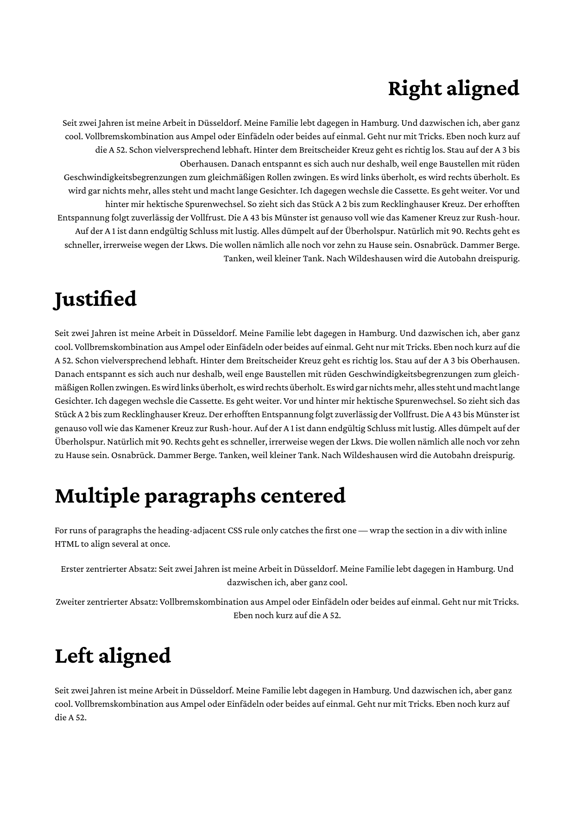
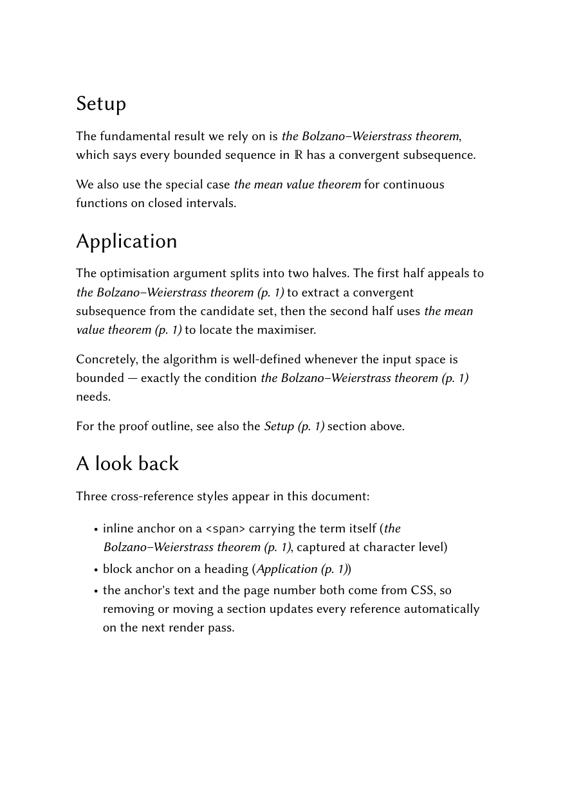
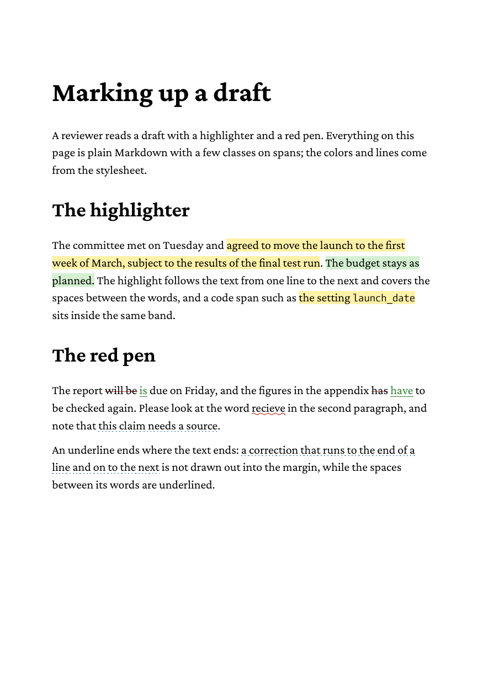
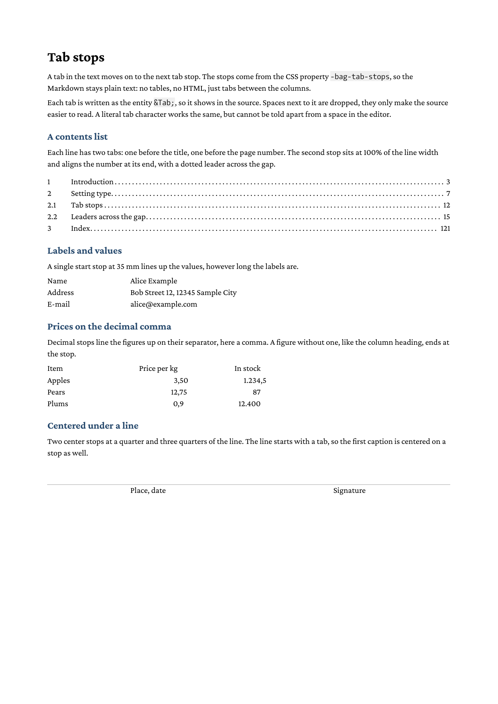
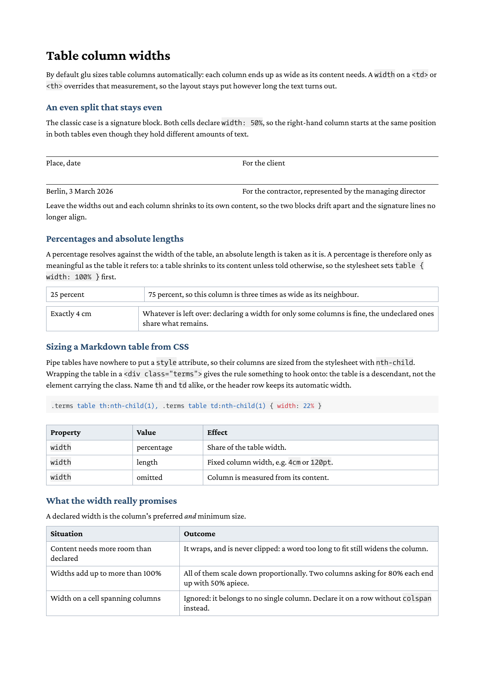
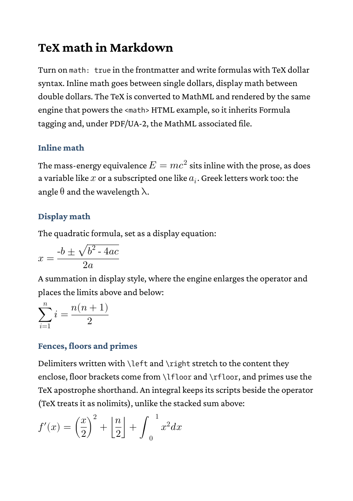
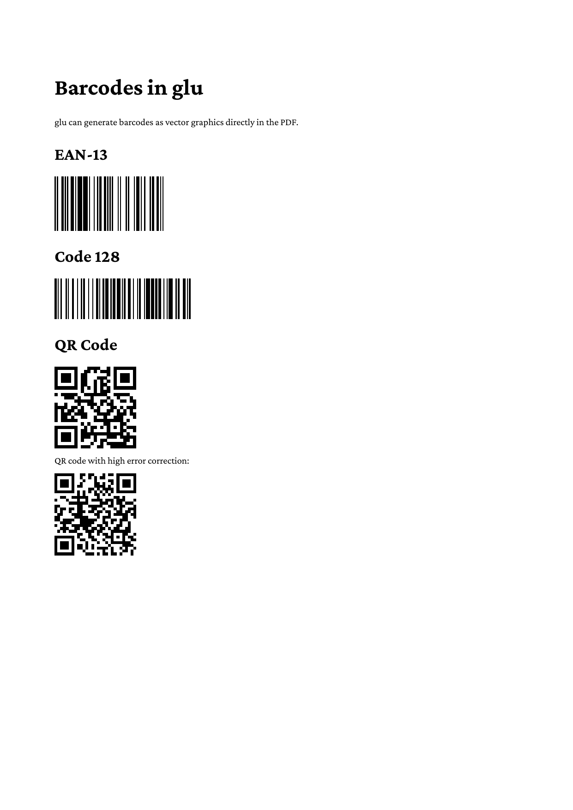

# Markdown examples

glu turns a `.md` file into a PDF. The file may start with YAML
frontmatter, hold Lua blocks (```` ```{lua} ````) and inline
expressions (`{= expr =}`), and mix in any HTML. Each example holds its
Markdown source, the `result.pdf` it makes and a `firstpage.png`
preview. Where the website has a how-to for an example, it is linked.

## Documents

Description | Preview
--- | ---
[Scientific paper](scientific-paper): a journal-style article in two columns with title block, abstract, numbered sections, equations, figures, a table, cross references and a running head, tagged as PDF/UA-2 ([how-to](https://boxesandglue.dev/glu/howto/scientific-paper/)) | <a href="scientific-paper"></a>
[Accessible report](accessible-report): `format: PDF/UA-2` in the frontmatter makes a tagged PDF 2.0 that passes veraPDF ([how-to](https://boxesandglue.dev/glu/howto/accessible-report/)) | <a href="accessible-report"></a>
[DIN 5008 letter](letter-din5008): a German business letter (DIN 5008 form B) with `position: absolute` fields for recipient, sender and fold marks beside the flowing body ([how-to](https://boxesandglue.dev/glu/howto/letter-din5008/)) | <a href="letter-din5008"></a>
[ZUGFeRD invoice](zugferd-invoice): an EN 16931 / Factur-X invoice as PDF/A-3b with the XML attached; a companion Lua file reads the XML and sets up the PDF ([how-to](https://boxesandglue.dev/glu/howto/zugferd-invoice/)) | <a href="zugferd-invoice"></a>
[Slides](slides): a 16:9 slide deck with a layout per slide and curves drawn with hobby | <a href="slides"></a>

## Text, references and tables

Description | Preview
--- | ---
[Alignment](alignment): `# Heading {.right}` classes, German hyphenation and the `-bag-linebreak-*` settings of the line breaker | <a href="alignment"></a>
[Table of contents](toc-target-counter): a contents list of links whose page numbers come from `target-counter()` and whose dot leaders from `leader()` ([how-to](https://boxesandglue.dev/glu/howto/toc-target-counter/)) | <a href="toc-target-counter"></a>
[Cross references](cross-reference-inline): `target-text()` and `target-counter()` pointing at headings and at inline anchors | <a href="cross-reference-inline"></a>
[Highlighting](highlighting): a highlighter with `background-color` on bracketed spans and a red pen with `~~strikethrough~~` and `text-decoration` in color, solid, wavy and dotted ([how-to](https://boxesandglue.dev/glu/howto/highlighting/)) | <a href="highlighting"></a>
[Tab stops](tab-stops): `-bag-tab-stops` on plain text: a contents list with a dot leader, a label and value block, prices aligned on the decimal comma and centered captions ([how-to](https://boxesandglue.dev/glu/howto/tab-stops/)) | <a href="tab-stops"></a>
[Table column widths](table-column-widths): `width` on `<td>` and `<th>` for HTML tables, and `nth-child` rules for Markdown pipe tables ([how-to](https://boxesandglue.dev/glu/howto/table-column-widths/)) | <a href="table-column-widths"></a>

## Math, charts and barcodes

Description | Preview
--- | ---
[TeX math](tex-math): `math: true` in the frontmatter and formulas in TeX dollar syntax, inline and displayed, tagged for PDF/UA-2 ([how-to](https://boxesandglue.dev/glu/howto/tex-math/)) | <a href="tex-math"></a>
[Chart from data](chart-from-data): a Lua block turns a Lua table into an SVG bar chart that goes into the page ([how-to](https://boxesandglue.dev/glu/howto/chart-from-data/)) | <a href="chart-from-data"></a>
[Barcodes](barcodes): EAN-13, Code 128 and QR codes with the `<barcode>` element ([how-to](https://boxesandglue.dev/glu/howto/barcodes/)) | <a href="barcodes"></a>

## Running an example

Inside the example's directory, run the command from its `check.json`,
or `glu <name>.md` for an example without one. glu writes the PDF and
an aux file, `<name>-aux.json`, which keeps cross references, the table
of contents and what Lua stores between runs. glu runs the document
again until the aux file no longer changes, so page numbers in cross
references are right after one call.

## How a Markdown file is processed

1. With `--template`, the file is first expanded as a Go
   `text/template`.
2. The YAML frontmatter is read: `title`, `author`, `lang`, `css`,
   `papersize`, `format` and `math` among others. The
   [glu documentation](https://boxesandglue.dev/glu/) lists all keys.
3. A Lua file of the same name, if there is one, is loaded and can
   register callbacks.
4. The aux file of the previous run is read and given to Lua as `_aux`,
   its headings as `_toc`.
5. Lua blocks are replaced by what they return, and inline `{= expr =}`
   by its value.
6. The Markdown becomes HTML (goldmark with tables, strikethrough,
   links, code highlighting and `{.class}` attributes).
7. htmlbag typesets the HTML, as for an HTML file.
8. The aux file is written, and if it changed, the document runs again.

## Features and where to find them

Feature | Example
--- | ---
`{.class}` on headings | `alignment`
Line breaker settings (`-bag-linebreak-*`), German hyphenation | `alignment`
`target-text()`, `target-counter(attr(href), page)` | `cross-reference-inline`, `toc-target-counter`
`leader()` with a dot pattern | `toc-target-counter`
`-bag-tab-stops`: start, end, center and decimal stops, leaders | `tab-stops`
`width` on table cells, `nth-child` column widths | `table-column-widths`
Inline `background-color`, `text-decoration` style and color, `~~strikethrough~~` | `highlighting`
`<barcode>` | `barcodes`
Lua blocks returning HTML or SVG, Lua modules | `chart-from-data`
`math: true` and TeX formulas | `tex-math`, `scientific-paper`
A layout per slide, hobby curves | `slides`
Companion Lua file, attachments, PDF/A-3b | `zugferd-invoice`
PDF/UA-2 | `accessible-report`, `scientific-paper`, `tex-math`

## PDF/UA

`format: PDF/UA` (or `PDF/UA-1`) in the frontmatter, together with
`lang` and `title`, makes a tagged PDF/UA-1 document: a structure tree,
`/MarkInfo`, `/DisplayDocTitle` and `pdfuaid:part 1` in the XMP
metadata. `format: PDF/UA-2` makes PDF/UA-2 on PDF 2.0: the structure
tree uses the HTML5 namespace, mapped to the PDF standard structure
namespace, the bookmarks point at structure elements, and the XMP
metadata carries `pdfuaid:part 2` and `pdfuaid:rev 2024`.

The XSL-FO examples [10](../xslfo/10-pdfua) and [11](../xslfo/11-pdfua2)
show both from XSL-FO input.
