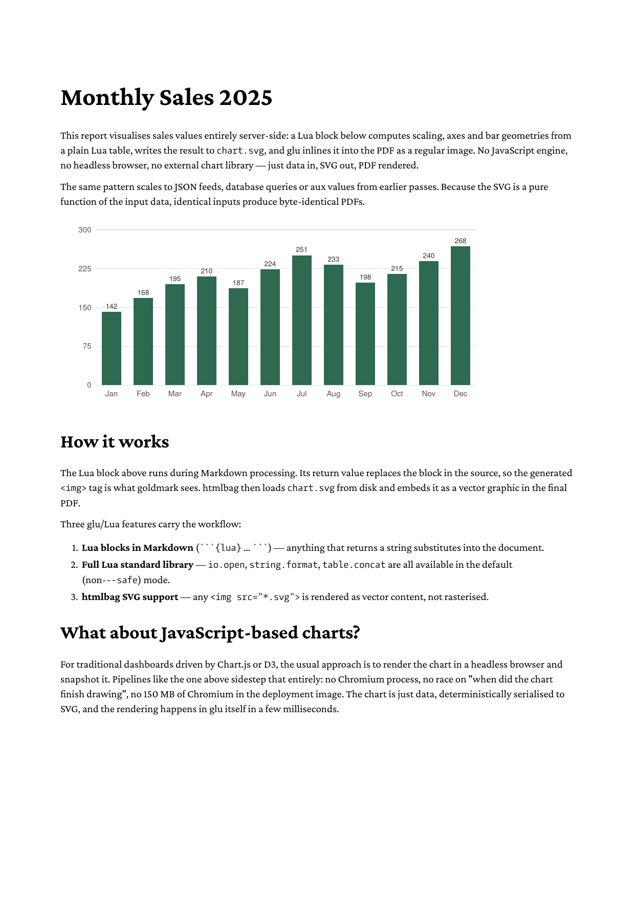

# chart-from-data

Server-side chart generation: a Lua block inside Markdown turns a plain
data table into an SVG bar chart, writes it to disk, and embeds it in
the PDF with a regular `` tag.

The how-to on the website explains the example step by step:
<https://boxesandglue.dev/glu/howto/chart-from-data/>.



## Run it

```
glu chart-from-data.md -o out.pdf
```

This writes `out.pdf` (this directory ships a copy as `result.pdf`)
and, as a side effect, `chart.svg` in the current directory, which you
can inspect or delete after the render.

## Why this matters

Charts are the most common reason teams reach for headless Chrome or
a JavaScript renderer in PDF pipelines. This example shows that for
many reporting use cases you can stay with pure Go:

- **Deterministic**: the same input data produces a byte-identical SVG
  and a byte-identical PDF.
- **Fast**: under 50 ms end to end, with no Chromium startup cost.
- **No external runtime**: no Node, no Chrome, no Python. Only glu
  and the Lua block.

## Extending the pattern

| Change | How |
|--------|-----|
| Read data from a JSON file | `local data = require("glu.json").read("data.json")` |
| Use values from a previous pass | Read `_aux.your_key` in the Lua block |
| Multiple charts in one report | Repeat the block; vary the output filename |
| Different chart type | Replace the bar geometry with line, area or pie path computations |

For more complex charts, move the SVG generation into a companion
`chart-from-data.lua` file and call its helpers from the Markdown
block. glu loads the companion file before the Lua blocks run.
