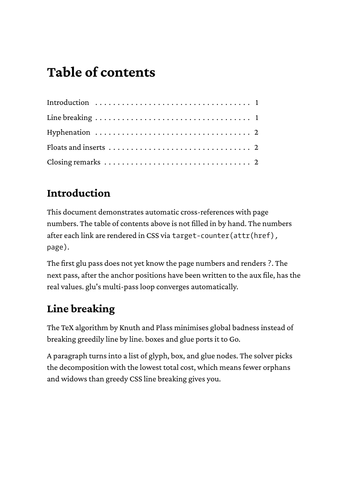

# target-counter and leader: automatic table of contents

This example shows CSS `target-counter(attr(href), page)` for
cross-references with page numbers, combined with `leader(" . ")` for
stretchy dot leaders. The table of contents at the top of `toc.md`
only contains links. The page numbers are generated in CSS from the
anchor positions, and the dots between title and page number are a
fil³-stretched glue with a repeated pattern (a TeX `\dotfill` in CSS
clothing). The [how-to](https://boxesandglue.dev/glu/howto/toc-target-counter/)
walks through it step by step.

The TOC entries sit in a fixed-width block (`.toc li { width: 9cm; }`)
so the leader has a definite stretch target. Without an explicit width
the leader would expand to the surrounding line width.

## Run

```
glu toc.md -o out.pdf
```

## What happens internally

glu renders the document multiple times:

1. **Pass 1:** page numbers are unknown. Every `target-counter()` call
   renders `?`. During layout the anchor positions of all `id="..."`
   elements are collected and written to the aux file (`out-aux.json`,
   named after the output file) under `_anchors`, with the page and
   the text of each anchor.

2. **Pass 2:** the aux file is read and the anchors are handed to the
   CSS evaluator. `target-counter()` calls now render real numbers. If
   the new layout shifts page positions further (a three-digit page
   number takes more space than `?`, or a TOC line wraps differently),
   a third pass runs.

3. **Convergence:** as soon as the aux file is identical between two
   passes, the loop stops. The default limit is `--max-passes 3`.

## Anchors

- Block-level ids are tracked: `## Introduction {#introduction}` and
  `<div id="anchor">` work.
- Inline ids, for example on a `<span>`, are tracked as well. The
  example [`../cross-reference-inline/`](../cross-reference-inline/)
  uses them. For TOC entries the id sits on the heading anyway.

## Leader notes

- `leader(" . ")` works inside mixed `content` of an `::after` (or
  `::before`) on an inline element, as here. `content: leader(" . ")`
  on its own, on an empty element, works too.
- `display: block` on the `<a>` itself breaks the layout because the
  `::after` content is set as inline content. Keep the link inline
  and the block boundary on the `<li>` (its default `display: block`).

## Result



## Reproducing result.pdf

`result.pdf` is built with a fixed timestamp, so a byte-for-byte
comparison against a fresh run catches regressions. To verify:

```
SOURCE_DATE_EPOCH=0 glu toc.md -o out.pdf
md5 out.pdf result.pdf   # both hashes must match
```

If the hashes differ, either the renderer changed (intentionally or
not) or font subsetting drifted. Check the first-page image and the
aux file before regenerating `result.pdf`.

## Related examples

- [`../../html/numbered-sections-counters/`](../../html/numbered-sections-counters/)
  uses `counters()` without anchor references, for hierarchical
  section numbers on nested lists.
