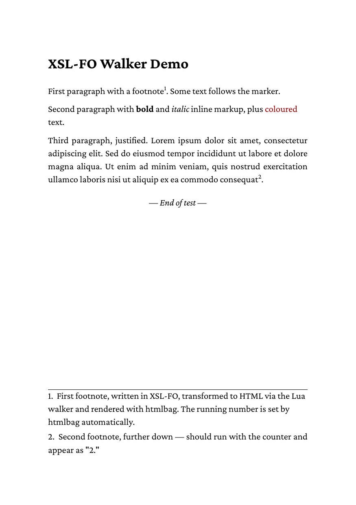

# 01 Basic walker

The smallest complete XSL-FO document for the walker: a page master,
blocks, inline markup (bold, italic, color) and two footnotes. It uses
no floats.

## Run

```
glu ../foproc.lua 01-basic.fo out=out.pdf
```

Run this inside the directory. It writes `out.pdf`; the directory
ships a copy as `result.pdf`.

## Result


