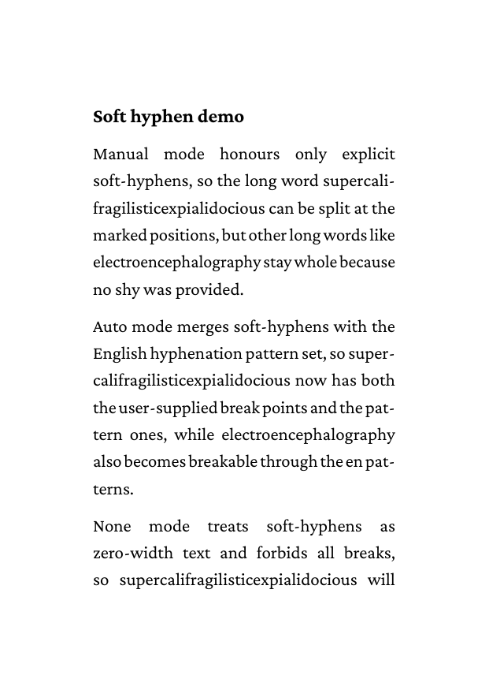

# 09 Soft hyphens

The CSS Text 3 `hyphens` modes side by side, set with the FO property
`hyphenate`:

| `hyphenate=` | CSS `hyphens` | Behavior |
|---|---|---|
| `manual` | `manual` | Breaks only at soft hyphens (U+00AD), no patterns |
| `auto` or `true` | `auto` | Pattern-based hyphenation plus soft hyphens |
| `false` | `none` | No hyphenation, soft hyphens are ignored |

The example uses `manual`, `auto` and `false`, in this order. Soft
hyphens are written as the XML character reference `&#xAD;`.
boxesandglue turns each one into a discretionary break, so the hyphen
appears only when the line breaker breaks the line there.

## Run

```
glu ../foproc.lua 09-soft-hyphen.fo out=out.pdf
```

Run this inside the directory. It writes `out.pdf`; the directory
ships a copy as `result.pdf`.

## Result


