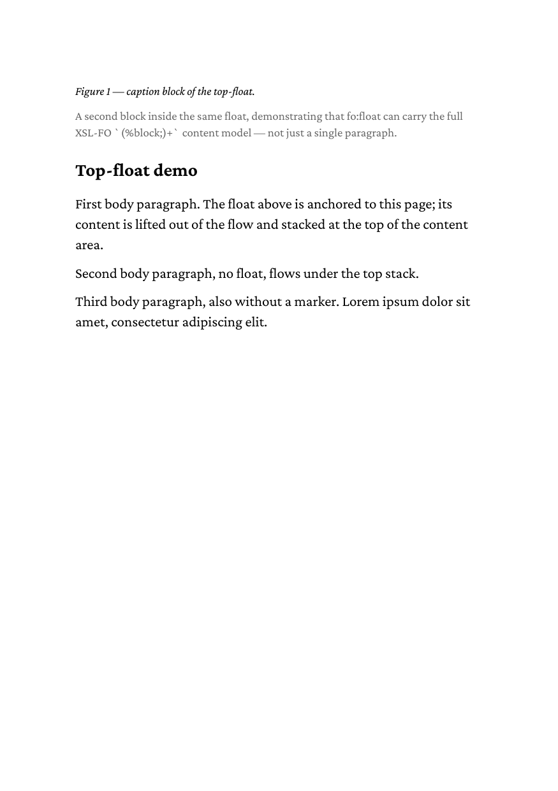
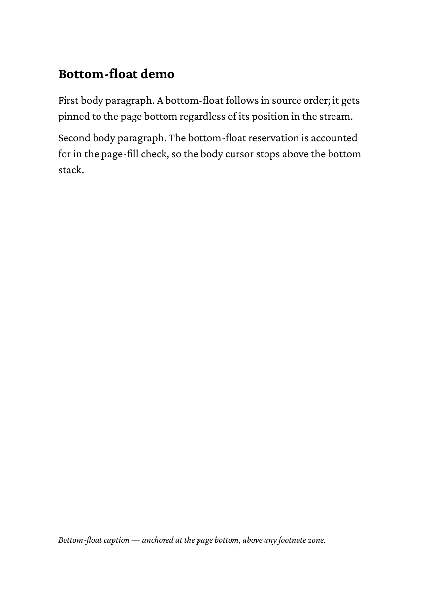
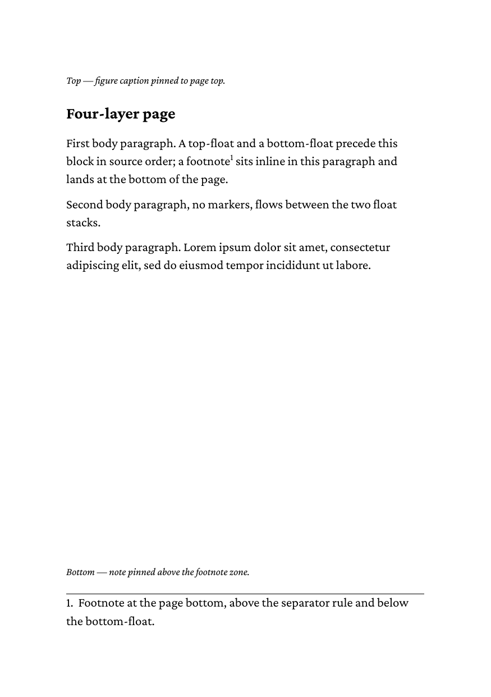
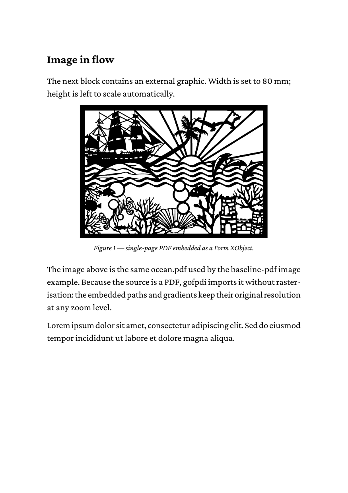
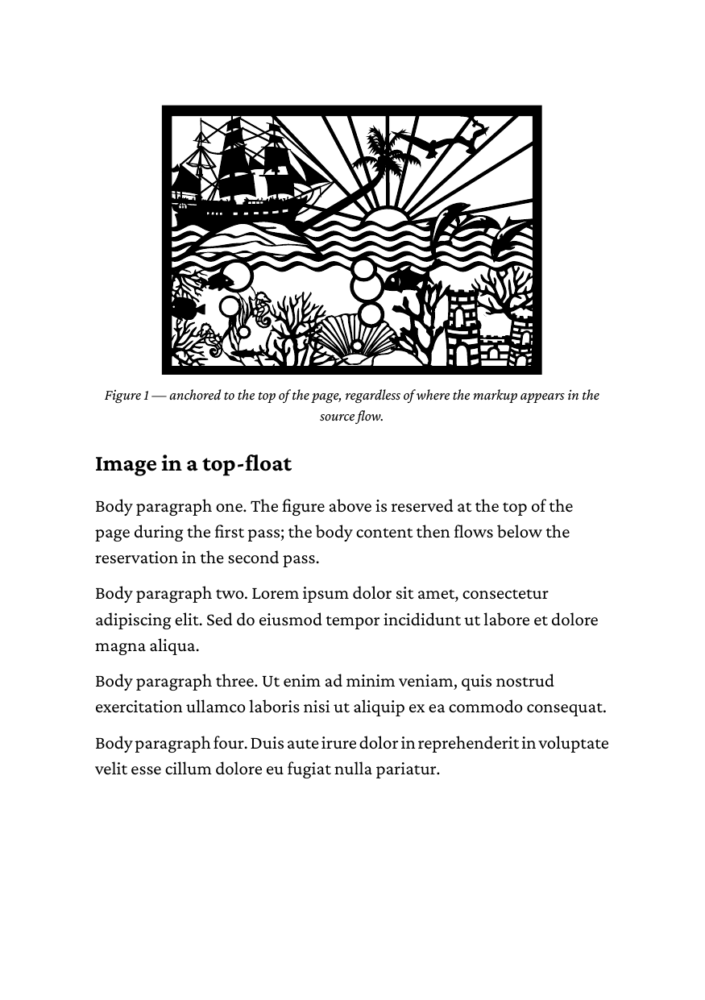
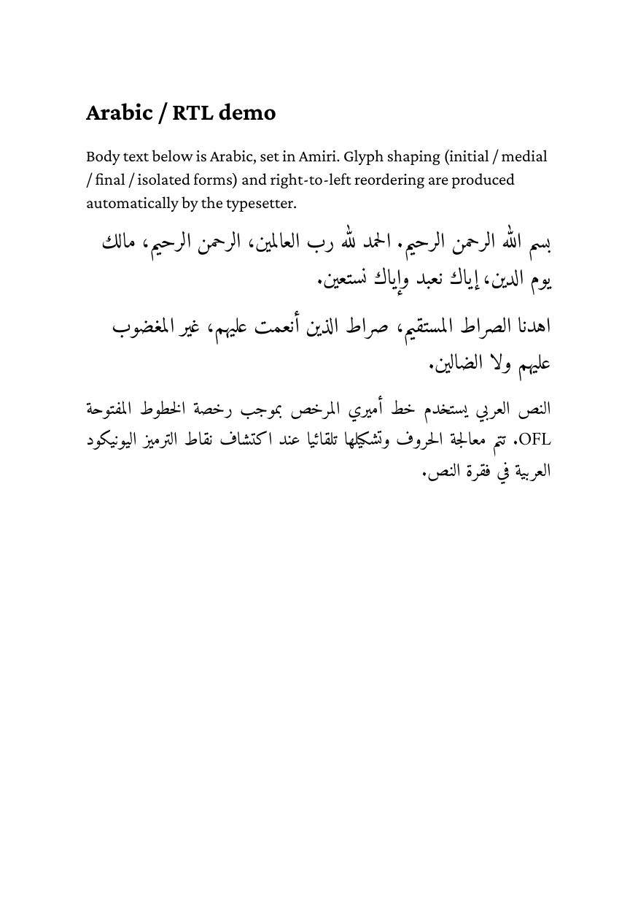
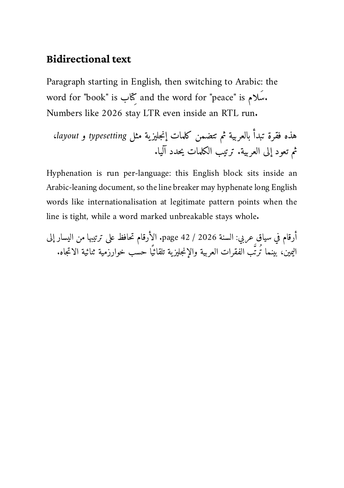
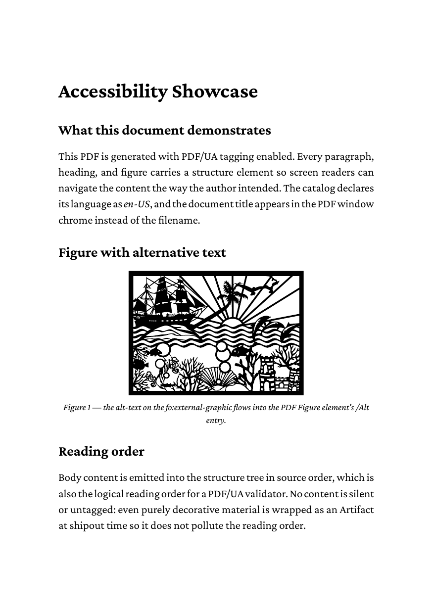
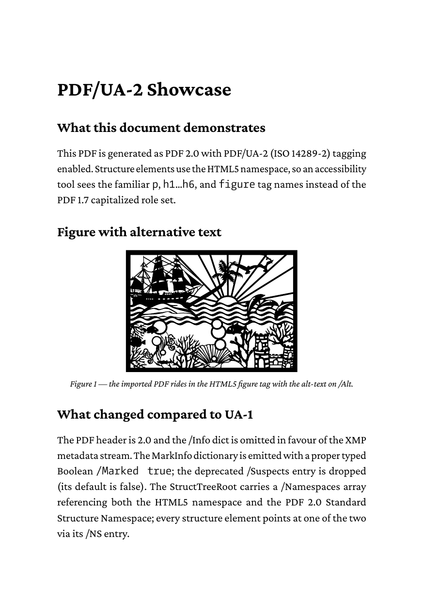

# XSL-FO examples

Eleven XSL-FO documents and the Lua walker that turns them into HTML
for htmlbag to typeset. The walker is a proof of concept, not a full
XSL-FO processor: it covers the most common formatting objects and
leaves out the rest.

Each example has its own directory with the `.fo` source, the
`result.pdf` it makes and a `firstpage.png` preview. The walker and the
shared files (`foproc.lua`, `ocean.pdf`, `amiri-*.ttf`) are in this
directory.

## Examples

Description | Preview
--- | ---
[01 Basic walker](01-basic): page master, blocks, inline markup and footnotes | <a href="01-basic"></a>
[02 Top float](02-float-top): `fo:float[float="before"]` with several blocks | <a href="02-float-top"></a>
[03 Bottom float](03-float-bottom): `fo:float[float="after"]` above the footnotes | <a href="03-float-bottom"></a>
[04 Floats and footnotes](04-float-mixed): top float, body, bottom float and footnote on one page | <a href="04-float-mixed"></a>
[05 Image in the flow](05-image): `fo:external-graphic` with a PDF, embedded as vectors | <a href="05-image"></a>
[06 Image in a top float](06-image-float): a figure with caption at the top of the page | <a href="06-image-float"></a>
[07 Arabic](07-rtl-arabic): Amiri through `bg:font-face`, with shaping and right-to-left order | <a href="07-rtl-arabic"></a>
[08 Mixed directions](08-mixed-ltr-rtl): English and Arabic in one paragraph, `xml:lang` per run and hyphenation per language | <a href="08-mixed-ltr-rtl"></a>
[09 Soft hyphens](09-soft-hyphen): the `hyphens` modes `auto`, `manual` and `none` | <a href="09-soft-hyphen"></a>
[10 PDF/UA-1](10-pdfua): a tagged PDF with headings, alternative text, `/Title` and `/Lang` | <a href="10-pdfua"></a>
[11 PDF/UA-2](11-pdfua2): the same on PDF 2.0, with the structure tree in the HTML5 namespace | <a href="11-pdfua2"></a>

## Running an example

Inside the example's directory, run glu with the walker and the `.fo`
file:

```bash
glu ../foproc.lua 01-basic.fo out=out.pdf
```

`out=out.pdf` sets the name of the PDF; without it, the walker writes
`01-basic.pdf`. The `result.pdf` in the repository is made the same
way. The HTML is built in memory. To keep it as a
file for a look or for debugging, add `keep-html`:

```bash
glu ../foproc.lua 01-basic.fo keep-html out=out.pdf
```

These are plain words rather than `--flags` because glu takes options
such as `--html` for itself before the script sees them.

## Shared files

File | Source and license
--- | ---
`foproc.lua` | The XSL-FO to HTML walker
`ocean.pdf` | The image also used by `baseline/image/`
`amiri-regular.ttf` | Amiri Regular (SIL Open Font License 1.1, see `amiri.license`)
`amiri-slanted.ttf` | Amiri Slanted, the italic of the Amiri family
`glu-xslfo.xpr` | Project file for Oxygen XML, not to be edited by hand

## What the walker translates

XSL-FO | HTML and CSS
--- | ---
`fo:simple-page-master` | `@page { size, margin }`
`fo:flow` | `<body>`
`fo:block` | `<p style="...">`
`fo:block role="H1..H6"` | `<h1>` to `<h6>`
`fo:inline` | `<span style="...">`
`fo:footnote`, `fo:footnote-body` | `<fn>...</fn>`
`fo:float[@float="before"]` | `<div style="float: top">`
`fo:float[@float="after"]` | `<div style="float: bottom">`
`fo:external-graphic` | ``
`fo:external-graphic alt="..."` | ``, the `/Alt` of the `Figure` in PDF/UA
`fo:declarations/bg:font-face` | `@font-face { font-family; src; font-weight; font-style }`
`xml:lang="en"` | `lang="en"`
`language="en" country="US"` | `lang="en-US"`
`hyphenate="true"`, `"false"`, `"manual"` | `hyphens: auto`, `none`, `manual`
`xml:lang` on `fo:root` | the document language, PDF `/Lang`
`bg:format="PDF/UA"` on `fo:root` | the PDF format, which turns on tagging
`fo:title`, a child of `fo:root` | the document title, PDF `/Title`

Compound properties such as `space-before.optimum` are not split up;
the walker translates the plain property name to the closest CSS.

`bg:font-face` lives in the extension namespace
`https://boxesandglue.dev/ns/xslfo`, declared on `fo:root` as
`xmlns:bg="..."`. XSL-FO 1.1 §6.4.2 allows elements of any other
namespace inside `fo:declarations`, so the document stays valid in
Oxygen XML and similar tools, where an `fo:font-face` would not (it is
not an XSL-FO element). It has the shape of CSS `@font-face`, so the
walker passes it on as it is.

## Right-to-left text

The walker sets `unicode-bidi: plaintext` on the body, so each
paragraph takes its direction from its first strong character, as
XSL-FO processors derive it from the text. The `.fo` files of 07 and
08 just hold the Arabic text and need no direction property. Arabic
shaping and the right-to-left order of the runs happen when the
paragraph is set.

## Hyphenation per run

The walker turns `xml:lang`, and the pair `language` and `country`,
into an HTML `lang`. htmlbag picks the TeX hyphenation patterns for
it and switches the language for that run. A language without
patterns, such as Arabic, Hebrew or Chinese, is not hyphenated, as
CSS Text 3 §6 asks.

The FO property `hyphenate` becomes CSS `hyphens`:

* `hyphenate="true"` is `hyphens: auto`: automatic hyphenation and soft hyphens
* `hyphenate="false"` is `hyphens: none`: no hyphenation at all
* `hyphenate="manual"` is `hyphens: manual`: only at soft hyphens (`&#xAD;`)

A soft hyphen in the text marks a possible break wherever `hyphens` is
not `none`. Example 09 shows the three modes side by side.

## PDF/UA tagging

`bg:format="PDF/UA"` on `fo:root` makes a tagged PDF. The walker reads
three settings from the root:

Source | Effect
--- | ---
`xml:lang` on `fo:root` | PDF `/Lang`, and the hyphenation language of the document
`bg:format="PDF/UA"` on `fo:root` | `/MarkInfo /Marked true`, a structure tree, `/DisplayDocTitle`, `pdfuaid:part 1` in the XMP metadata and the role of every element
`<fo:title>`, a child of `fo:root` | PDF `/Title`, also `dc:title` in the XMP metadata

In the flow:

Source | Structure element
--- | ---
`<fo:block role="H1">` to `role="H6"` | `H1` to `H6`
`<fo:block>` | `P`
`<fo:external-graphic alt="...">` | `Figure` with `/Alt`
`<fo:inline>` | `Span`

`pdfinfo` shows the title, the language and whether the file is
tagged; `veraPDF --profile PDF/UA-1` checks it against ISO 14289-1.
Example 10 uses all of the above, example 11 the same with
`bg:format="PDF/UA-2"`.

## What the walker leaves out

The walker does not translate side floats (`float="start"`, `"end"`,
`"inside"`, `"outside"`), `fo:marker` and `fo:retrieve-marker`,
`fo:repeatable-page-master-alternatives`, `fo:page-number-citation`
and multi-column regions. Such elements are passed on in part or
dropped. htmlbag itself can do several of these from HTML and CSS:
side floats, multi-column layout and running headers and footers, see
the [HTML examples](../html).

The CSS and HTML that htmlbag supports are described in the
[htmlbag documentation](https://boxesandglue.dev/htmlbag/).
